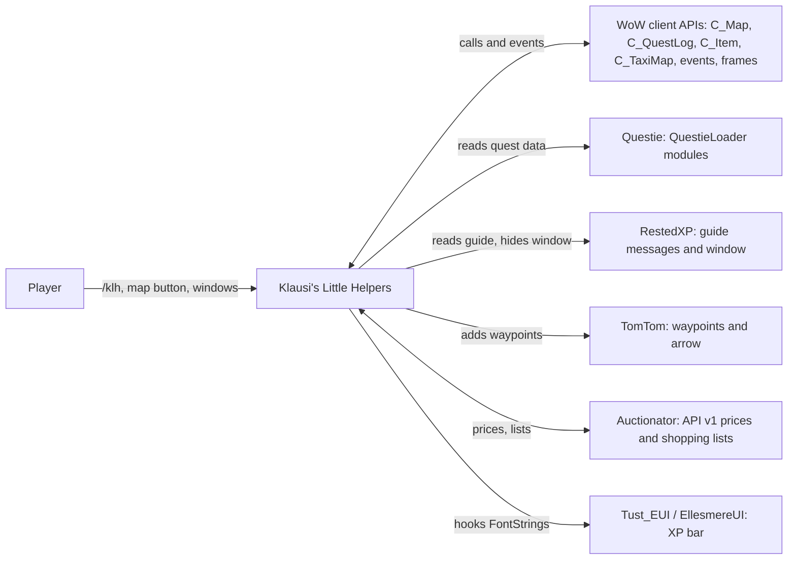
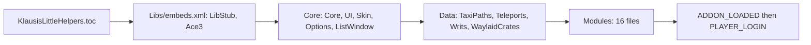
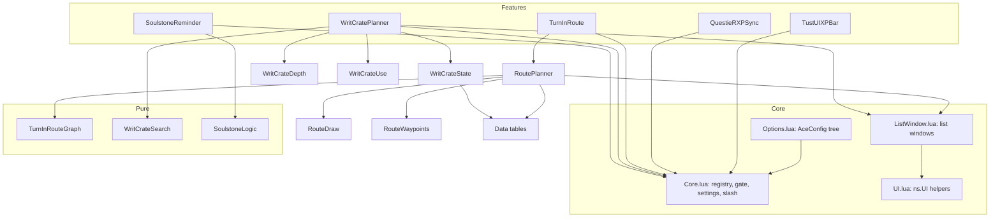

# Architecture Overview

## System Context

KLH runs inside the WoW client as a Lua addon. It talks to the player through frames and slash commands, reads game state through Blizzard APIs, and extends other addons through their public globals.

Notes:

- Questie, RXPGuides, Tust_EUI, EllesmereUI, TomTom and Auctionator are listed as `OptionalDeps` in the TOC. A feature that needs one lists it in `requires` and stays off without it. TomTom (Turn-in Route) and Questie (RestedXP Quest Sync) are only `optional`; each section's `optional` line says so.
- Saved data goes to two SavedVariables: `KLH_DB` (account-wide AceDB store with per-character profiles) and `KLH_CharDB` (per character).

## Container View: Load Order

The TOC defines the only "container" structure. Files load in this order, and the order matters because later files read what earlier files put on the shared `ns` table.

1. **Libs**: `Libs\embeds.xml` includes LibStub, CallbackHandler, AceEvent, AceDB, AceDBOptions, AceGUI and AceConfig.
2. **Core**: `Core.lua` (namespace, registry), `UI.lua`, `Skin.lua` (optional EllesmereUI look), `Options.lua`, `ListWindow.lua`.
3. **Data**: generated tables. Each file starts with `if ns.IS_FOREVER == false then return end`, so retail never builds them.
4. **Modules**, in this order: `WritCrateSearch`, `WritCrateState`, `TustUIXPBar`, `QuestieRXPSync`, `TurnInRouteGraph`, `RouteDraw`, `RouteWaypoints`, `RoutePlanner`, `TurnInRoute`, `WritCrateHistory`, `WritCrateDepth`, `WritCrateUse`, `WritCratePlanner`, `SoulstoneLogic`, `SoulstoneReminder`, `LayerPrompt`. The feature registration order (and so the order inside each options tab) follows this list: XP bar, RestedXP Quest Sync, Turn-in Route, Writ & Crate Planner, Soulstone Reminder, Layer Change Prompt.
5. **Runtime**: `ADDON_LOADED` for this addon builds the options. `PLAYER_LOGIN` enables the features.

`.tools/check-toc.lua` fails the check when a TOC entry is missing on disk or a `.lua` file (outside `scripts/`, `tests/`, `Libs/`, `.tools/`) is not listed.

## Component Architecture

The `Pure` group has no game API calls at load or in its public functions, so the test runner can load it with plain Lua. `RoutePlanner`, `WritCrateState` and `WritCrateDepth` mix pure functions (`RP.MergeStops`, `RP.RestoreKeep`, `W.BuildCandidates`, `W.Observe`, the `W.Learner` methods, `D.Cost`, `D.PlanCost`) with game-facing code. `RouteDraw` and `RouteWaypoints` are game-facing and are exercised through stubbed `RoutePlanner` tests.

## Architectural Patterns

- **Feature registry.** `ns.RegisterFeature(spec)` stores the spec in `ns.features` and its key in `ns.featureOrder`. The spec holds `key`, `title`, `description`, `help`, `tab`, `section`, `requires`, `optional`, `optionalReason`, `alwaysOn`, `defaults`, `commands`, `enable(settings)`, `disable(settings)`, `options(settings)` and `onReset()`. The core never knows what a feature does.
- **Central client gate.** `ns.FEATURE_CLIENTS` maps each key to `"all"`, `"forever"` or `"retail"`. A key that is missing loads nowhere (and `RegisterFeature` prints a one-time developer error). `ns.ClientAllows` is used in three places: `RegisterFeature` (does not register on the wrong client), `ShouldEnable`, and `ns.BuildOptionsTable` (no page on the wrong client). One table, one rule.
- **Required-addon gating.** `ns.MissingAddons(spec, isLoaded)` lists missing `requires`. `ShouldEnable` returns false when any is missing. `enable` is then never called, so the feature hooks nothing. Features also re-check at the top of `enable` for the specific globals they use (for example `_G.QuestieLoader`, `_G.TustEUI`).
- **AceDB per-character profiles.** `LibStub("AceDB-3.0"):New("KLH_DB", { profile = { features = {} } })` has no default profile name, so each character gets its own profile. `ns.GetSettings(key)` returns `profile.features[key]` with a read-through metatable on the spec defaults (table defaults are deep-copied on first read). Profile switch, copy and reset callbacks refresh the options.
- **AceConfig options with greyed "Requires" pages.** `ns.BuildOptionsTable` builds a tab group (General, QoL, Helpers, 3rd Party, Profiles) with one box per feature, placed by `spec.tab` and grouped under `spec.section` when set (one box per section, its features flat under header lines). Each section shows its `help`, and an `optional` line ("Uses X if installed" or "Install X for <optionalReason>"). When addons are missing, every option is `disabled`, its description gets a "Requires: X, Y" prefix, the section name turns grey, a `requires` line comes first, and an `unavailable` summary on the General tab lists all gated features.
- **Pure tested modules split from game-facing ones.** `TurnInRouteGraph`, `WritCrateSearch` and `SoulstoneLogic` are pure. `TurnInRoute` (feature wiring) is separate from `RoutePlanner` (engine, list window, saved route), `RouteDraw` (map lines and markers) and `RouteWaypoints` (TomTom). `WritCrateState` holds data-shaping functions and the event-order `Learner` that take their inputs as arguments, while `WritCratePlanner` owns frames and events.
- **Live switching.** A spec with `disable` can be turned on and off without a reload: `ns.ApplyFeature(key)` runs `enable` or `disable` when `ns.ShouldEnable` and `ns.IsRunning` differ. Only Soulstone Reminder uses it; every other switchable feature asks for a reload.
- **Defer and degrade instead of crash.** `UI.Defer` queues work until combat ends. `EnableFeatures` runs each `enable` under `xpcall` with the game's error handler, so one bad feature does not stop the others. `RP.Collect` wraps each source in `pcall`.

## Key Design Decisions

1. **One central client table instead of per-file checks.**
   - Rationale: a new feature cannot load on a wrong client by accident, and the options and registry agree.
   - Trade-off: a new feature must also be added to `ns.FEATURE_CLIENTS`, or it silently loads nowhere.

2. **Features are always on by default.**
   - Rationale: fewer settings and no reload prompts. Every feature already stays inactive when its addons are missing. Only a feature registered without `alwaysOn` gets an Enable toggle and a reload prompt.
   - Trade-off: of the six features only RestedXP Quest Sync and Soulstone Reminder have the toggle (Soulstone switches live). The other four can only be disabled by disabling their addon dependency; Layer Change Prompt has none and always runs on Forever.

3. **Data files return early on retail.**
   - Rationale: the Forever-only tables are large (taxi paths, writs). Skipping them saves memory and load time on retail (commit "perf: skip the Forever-only data tables on retail"). `retaildata_test.lua` guards this.
   - Trade-off: code that reads `ns.TaxiPaths` or `ns.Data.Writs` must only run on Forever. The features that use them are Forever-only.

4. **Generated data, never edited by hand.**
   - Rationale: game data comes from DB2 exports, QuestieDB and Wowhead tooltips. `scripts/taxi-data.py` and `scripts/writ-data.py` rebuild the files in a repeatable way, and they write ASCII only.
   - Trade-off: the generators need external inputs (CSV exports, a QuestieDB checkout, a tooltip cache).

5. **Route planning as graph search with a small travelling-salesman step.**
   - Rationale: shortest travel times between all stops (Dijkstra with a binary heap over ground, flight, boat and shortcut edges), then ordering the stops. For up to 12 vertices (start included) the order is exact (bitmask DP); above that, greedy plus 2-opt (cost change computed incrementally, public as `G.TwoOpt`) plus Or-opt.
   - Trade-off: heuristic above 12 vertices. Flight and boat times are estimates (the flight speed is learned from real flights).

6. **Learn from the player instead of trusting data.**
   - Rationale: some values (Artisan crate Favor, writ rep past Friendly) were unconfirmed. The planner observes real turn-ins and stores them in `KLH_CharDB`.
   - Trade-off: observations are per character, and only appear after the first turn-in.

7. **Plain-Lua test runner instead of a WoW mock framework.**
   - Rationale: tests run with `lua5.1` in under a second and in CI without WoW. Tests stub the few globals they need.
   - Trade-off: frame-heavy code (windows, markers) is not covered.

8. **Single list-window widget shared by two features.**
   - Rationale: the route window and the planner window look and behave the same (draggable, remembered position, rows, bottom buttons).

## Module Breakdown

### Core
- **Purpose**: registry, client gate, settings, slash command, UI helpers, options, list window.
- **Key components**: `ns.RegisterFeature`, `ns.FEATURE_CLIENTS`, `ns.GetSettings`, `ns.ApplyFeature`, `ns.RegisterSlashCommand`, `ns.UI`, `ns.BuildOptionsTable`, `ns.CreateListWindow`, `ns.ListWindowLayout`.
- **Dependencies**: AceDB, AceDBOptions, AceConfig, AceConfigDialog, AceConfigRegistry.

### Route Planner
- **Purpose**: plan and show a turn-in route.
- **Key components**: `ns.RouteGraph`, `ns.RoutePlanner`, `ns.RouteView` (`RouteDraw.lua`), `ns.RouteWaypoints`, `ns.TurnInRoute`, `ns.TaxiPaths`, `ns.Transports`, `ns.Teleports`.
- **Dependencies**: Questie (`QuestieDB`, `ZoneDB`, `DistanceUtils`, `HBD`), Krowi_WorldMapButtons, TomTom (optional), RestedXP (paused on start).

### Writ & Crate Planner
- **Purpose**: cheapest writ, crate and receipt plan, Auctionator list, receipt and crate-fill macros, learning from turn-ins.
- **Key components**: `ns.WritSearch`, `ns.WritState` (including `WritState.Learner`), `ns.WritDepth` (AH listing costs), `ns.WritUse` (secure buttons and macros), `ns.WritPlanner`, `ns.Data.Writs`, `ns.Data.WaylaidCrates`.
- **Dependencies**: Auctionator API v1, `C_AuctionHouse` (listing lookups at the AH).

### RestedXP Quest Sync
- **Purpose**: keep Questie's tracker in step with the RestedXP guide.
- **Dependencies**: RestedXP, Questie (optional), AceEvent-3.0 (vendored in `Libs/`).

### TustUI XP Bar
- **Purpose**: extra XP numbers on TustUI's bar.
- **Dependencies**: Tust_EUI and EllesmereUI (both required; helpers `EUI.L`, `EUI.Lf`, `EUI.AbbreviateNumber`).

### Soulstone Reminder
- **Purpose**: banner, chat and sound when a warlock's soulstone is ready and no healer has one (Forever, QoL tab).
- **Key components**: `ns.Soulstone` (`SoulstoneLogic.lua`, pure), `SoulstoneReminder.lua` (events, banner, chat, `KLH` addon-message peers).
- **Dependencies**: none. Switches live through `disable`.

### Layer Change Prompt
- **Purpose**: re-anchors Blizzard's `ShardTransferImminentFrame` (and lifts its minimize button) to a saved, draggable holder at strata DIALOG (Forever, QoL tab).
- **Key components**: `LayerPrompt.lua` (`ns.LayerPrompt`): holder frame, `OnShow` hook that re-anchors on every show, Move/Lock (or right-click) and Reset options.
- **Dependencies**: none; waits for `ADDON_LOADED` of `Blizzard_SocialToast` when its frame is missing at login.

Each component has a file in `4. Deep Dive/`.
