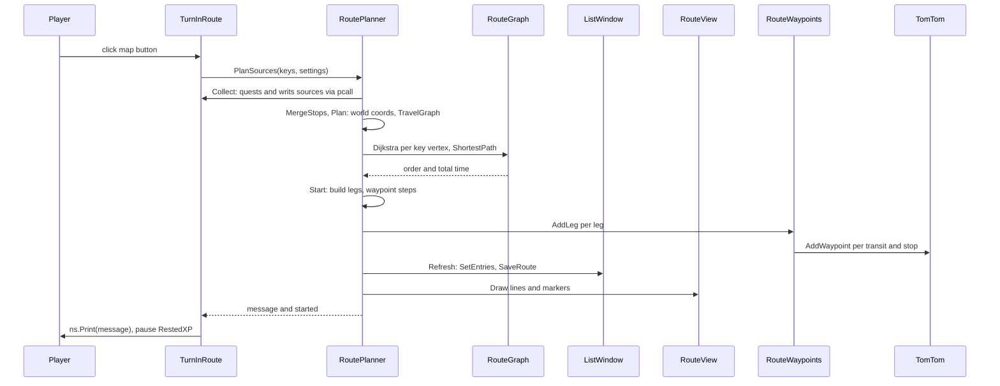
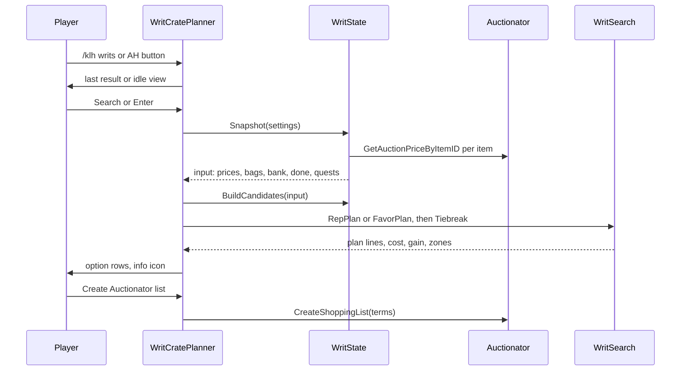
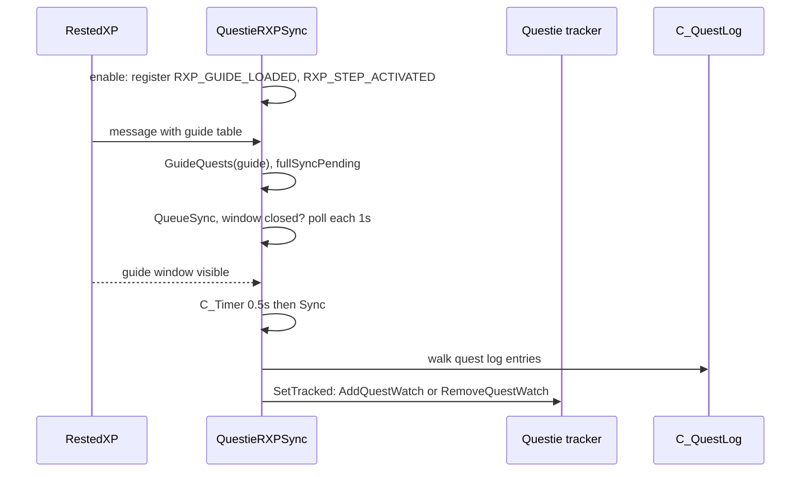
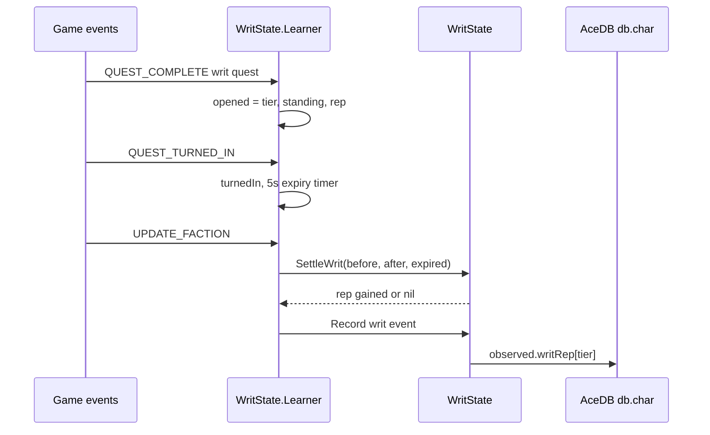
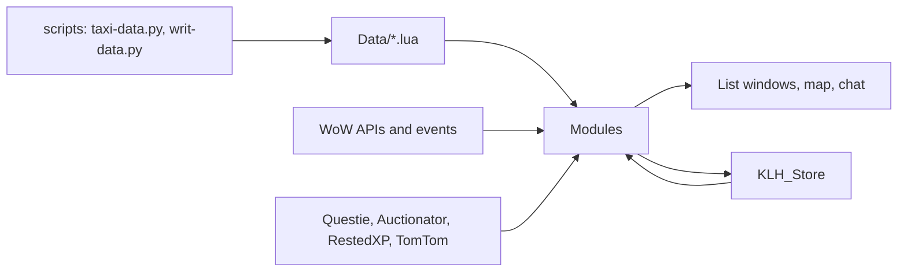

# Workflow Overview

## Core Workflows

### 1. Addon load and feature enable

Files load in TOC order. Each module registers its feature while loading. The work starts at two events.

```mermaid
sequenceDiagram
    participant WoW as WoW client
    participant Core as Core.lua
    participant Mod as Module file
    participant Opt as Options.lua
    participant F as Feature enable

    WoW->>Core: load Core.lua, create loader frame
    WoW->>Mod: load each module in TOC order
    Mod->>Core: RegisterFeature(spec)
    Core->>Core: ClientAllows? else skip
    WoW->>Core: ADDON_LOADED for this addon
    Core->>Opt: ns.RegisterOptions()
    WoW->>Core: PLAYER_LOGIN
    Core->>Core: EnableFeatures, ShouldEnable per feature
    Core->>F: xpcall(spec.enable, errorhandler, settings)
```

Steps:

1. `Core.lua` sets `ns.IS_FOREVER` (client build between 16000 and 19999), creates `ns.features`, `ns.featureOrder`, exports `_G.KLH`, and creates the loader frame for `ADDON_LOADED` and `PLAYER_LOGIN`. It also registers `SLASH_KLH1..3` and `SlashCmdList.KLH`.
2. Data files load. On retail they return at once.
3. Each module calls `ns.RegisterFeature`. The call asserts a key and an `enable` function, rejects duplicates, and returns without registering when `ns.ClientAllows(key, ns.IS_FOREVER)` is false. A key missing from `ns.FEATURE_CLIENTS` prints a one-time developer error and registers nothing. It also records the spec's `commands` in `commandOwner`.
4. On `ADDON_LOADED` for `KlausisLittleHelpers`, `ns.RegisterOptions()` creates the AceDB store, the options table, the reload popup and the Blizzard AddOns entry.
5. On `PLAYER_LOGIN`, `EnableFeatures` builds a context (`isForever`, `isLoaded`, `enabled`) for each feature. `ns.ShouldEnable` needs the client to match, no missing `requires`, and `alwaysOn` or a saved `enabled` flag. A passing feature is marked in `enabledAtLoad` and its `enable(settings)` runs under `xpcall`. Later, `ns.ApplyFeature(key)` does the same for a spec with `disable`, or runs `disable` when it should stop (Soulstone Reminder).

### 2. Opening the options

1. `/klh` calls `ns.OpenOptions()`, which opens KLH's settings window.
2. `ns.BuildOptionsTable` builds the options tree. The model turns it into sidebar entries and page controls; the window renders them with `ns.Widgets`.
3. Feature options include help, optional dependencies, and disabled controls with requirement messages where needed. Sectioned features share a page.
4. AceDBOptions supplies Profiles. Profile changes apply live features, request a refresh and show a reload prompt when required.
5. The Blizzard AddOns panel opens the same window through `ns.OpenFromSettings()` after closing Settings.

### 3. Planning a route (Turn-in Route)



Steps:

1. A left click calls `T.Plan(nil)`, which uses every registered source. A right click opens `UI.ContextMenu` with "Plan all", one entry per source and, when a route is active, "Abort route".
2. `RP.PlanSources` calls `RP.Collect`. Source `quests` (`CollectTurnIns`) reads the quest log, keeps quests where `QuestieDB.IsComplete(id) == 1`, and takes the nearest finisher spawn from `DistanceUtils.GetNearestFinisherOrStarter`. Source `writs` (`CollectWrits`) uses `T.ReadyWrits` on `ns.Data.Writs` with bag counts. Writ quests are skipped by the quests source so they are not counted twice. Stops with no location are counted as `unknown`.
3. `RP.MergeStops` merges stops at the same place (map ID and coordinates rounded to 0.001) and combines their quests.
4. `RP.Plan` converts every stop to world coordinates with HereBeDragons and builds the travel graph (`TravelGraph`): the start, the stops, taxi nodes of each continent involved (undiscovered nodes and wrong-faction nodes dropped), ship docks from `ns.Transports`, and landing points for the hearthstone and teleports. Edges are ground (distance x 1.3 / speed), flight (`G.FlightTimes` plus 20 s overhead), boat and start-to-shortcut jumps.
5. `G.Dijkstra` (binary heap) runs from each stop vertex to fill a cost matrix. `G.ShortestPath` orders the reachable stops (exact up to 12 vertices, else greedy plus `G.TwoOpt` and Or-opt). `G.Steps` turns each leg into steps (ground steps merged).
6. `RP.Start` removes the old route's waypoints when needed, and applies `RP.WaypointSteps(mode, hasOldRoute)`: `add` keeps your waypoints, `replace` clears all TomTom waypoints first. For each leg `RouteWaypoints.AddLeg` adds one waypoint per flight or boat step and one for the stop.
7. `Refresh` fills the list window, saves the route to `db.char.turnInRoute.route`, draws lines and numbered markers on the world map (`RouteView.Draw`) and points the TomTom arrow at the first leg (`RouteWaypoints.ArrowTo`).
8. `T.Plan` prints the summary, and when a route started it hides the RestedXP guide window with the `/rxp hide` command if it was showing.
9. While the route runs, events update it: `QUEST_TURNED_IN` and `QUEST_REMOVED` remove a finished quest, `PLAYER_CONTROL_LOST` detects taking a taxi (`RouteWaypoints.OnTaxiTaken`) and marks the flight step as passed, and reaching a waypoint drops the leg. Three seconds after login `RP.Restore` rebuilds a saved route and drops quests that are completed.

### 4. Writ & Crate Planner



Steps:

1. `ToggleWindow` or `Open` builds the window once (`EnsureWindow`, via `ns.CreateListWindow`). It shows the last result, or an idle view when there is none or it is out of date (rep or Favor changed, or the daily reset passed). Opening never calculates. In combat, opening is deferred with `UI.Defer`.
2. Search (or Enter in the amount box) calls `Render`, which calls `Calculate`. Only Search calculates: switching Rep/Favor and Reset go back to the idle view and stop a running lookup, and settings changes apply on the next Search. `WritState.Snapshot` counts bag items (and the saved bank scan when `countBank` is on), reads quest state (`IsQuestFlaggedCompleted`, `IsOnQuest`), and reads the lowest price and its age from Auctionator for every writ, requested item, crate and bundle item.
3. `WritState.BuildCandidates` makes the writ candidates (faction filter, done-today filter, level 10 minimum, cost = writ price unless owned + the requested items at their AH price even when owned, rep = observed value or table value) and crate candidates (cheapest bundle to fill, owned or buyable). Anything without a price goes to `unpriced`.
4. The target comes from the amount box. In rep mode a dropdown arrow inside the box lists Friendly to Exalted; picking one only writes its gap (`P.GainTo(standing, target)`, step sizes 3000, 6000, 12000, 21000) into the box.
5. Mode `favor` calls `S.FavorPlan`. Mode `rep` calls `S.RepPlan`, which tries each count of Forged Delivery Receipts (50 rep each, 15 Favor each, from Friendly on) and picks the cheapest feasible mix, then `S.Tiebreak(plan, writs, level)` for each level in `{ 0, 0.05, 0.1, 0.2, 0.4 }`, which swaps writs to reduce the number of zones while the total stays within that fraction above the cheapest. `P.Frontier` keeps the options that save zones, and a "Fewest buys (N items)" option is added when it needs fewer items than all of them. At the AH, items bought in large amounts are then priced from their live listings.
6. The window lists one row per option with cost and zones, and a chevron when the plan is cheap or dear against the usual price from Auctionator's history; hovering a row shows its cost, gain, zones and groups, and clicking it shows its lines. The info icon in the title bar holds the price source, scan age, Friendly cap, level and reset lines and the unpriced items.
7. "Create Auctionator list" turns the plan into one exact search term per item with `P.ShoppingTerms` (minus what you own) and calls `auc.CreateShoppingList(CALLER, "KLH Writs" or "KLH Crates", terms)`.

### 5. RestedXP Quest Sync on login



Steps:

1. `enable` gets `QuestieTracker` from `QuestieLoader:ImportModule`, embeds AceEvent into a listener table, registers the two RestedXP messages, registers `QUEST_ACCEPTED` on a frame and hooks `RXPFrame` `OnShow`. It returns early if AceEvent is not available.
2. At login RestedXP sends its guide before its window is visible, and no `OnShow` follows. `QueueSync` therefore polls `GuideOpen()` every second, up to 30 tries (`WaitForWindow`).
3. When the window is open, `Sync` runs after a 0.5 s delay. A full sync walks the quest log and tracks quests in the guide, untracks the others. Later syncs only handle newly accepted quests.
4. `GuideQuests` reads quest IDs from guide steps with tags `accept`, `turnin`, `complete`, `collect`, `daily`, `dailyturnin`, `questgoto` and `questwaypoint`.
5. Nothing changes while the guide window is closed.

### 6. Learning from turn-ins

The planner listens for real game events and corrects its data. Observations are stored per character in `db.char.WritCratePlanner.observed`. The planner's event frame only forwards events to `ns.WritState.Learner` (`Modules/WritCrateState.lua`), whose methods return the observations to record.



Writs:

1. `QUEST_COMPLETE` for a writ quest (looked up through `GetQuestID()`) stores the standing before the turn-in, if the standing is below Exalted (8).
2. `QUEST_TURNED_IN` with the same quest ID starts a 5 second window. `pastFriendly` is true when the standing is Friendly (5) or higher.
3. `UPDATE_FACTION` calls `learner:OnFaction`; the timer calls `learner:Tick`. `W.SettleWrit` returns the standing gain. If the timer expires, nothing changed and the standing is Friendly or higher, it returns 0 (writs give no rep past Friendly).
4. `W.Record` stores `writRep[tier].rep` (when above 0) and `pastFriendly.yes` or `.no`. Later `BuildCandidates` rounds this rep down to a multiple of 25 and uses it, and `W.PastFriendly` makes the planner cap writ rep at the amount up to Friendly when it saw 0.

Crates:

1. `CURRENCY_DISPLAY_UPDATE` for currency 3402 (Merchant's Favor) with a positive change creates a `pendingGain`.
2. `BAG_UPDATE_DELAYED` compares bag counts and notes sealed crates that left the bags (`departed`).
3. `ResolveGain` pairs a gain with exactly one crate kind that departed within 5 seconds (`W.DepartedCrate`), validates it with `W.CrateFavor` and records `sealedFavor["<tier>:<kind>"]`. Later candidates use that value and mark the crate as confirmed.

## Data Flow



Inputs are the generated tables, live game state and other addons' data. Outputs are windows, map overlays, TomTom waypoints, chat messages and the `KLH_Store` SavedVariable.

## State Management

| Store | Scope | Written by | Content |
|---|---|---|---|
| `KLH_Store.database` | account, AceDB with one profile per character by default | `ns.GetSettings(key)` and options `set` callbacks | `profile.features[key]` settings: feature defaults, `windowPoint`, user choices; `global.FarmTracker.areas` stores shared area history across characters. |
| `db.char` | per character | feature code | `turnInRoute` (`mountSpeed`, `mountSamples`, `taxiSpeed`, `taxiSamples`, `bind`, `route`), `WritCratePlanner` (`bank` scan, `observed`, `plan`: `mode`, `target`, `goal`), `tustXPBar` (`xp`, `time`). |
| Module locals | session | each module | Route legs, markers, RestedXP Quest Sync pending flags, planner window state (`state.mode`, `state.pick`, `state.view`), `last` result. |

Default feature settings:

- `TustUIXPBar`: `showSessionXP = true`, `rateSource = "session"`.
- `TurnInRoute`: `useHearth = false`, `useTeleports = false`, `waypoints = "add"`.
- `WritCratePlanner`: `countBank = false`, `useFavorForReceipts = false`, `liveMinQty = 10`, `priceMethod = "typical"`, `historyDays = 14`, `minDays = 5`, `cheapBelow = 15`, `highAbove = 15`, `dontBuyAbove = 50`, `marketShare = 25`.
- `SoulstoneReminder`: `instances = "both"`, `banner = true`, `announce = false`, `whisper = false`, `sound = false` (plus `enabled`, off until switched on).
- `LayerPrompt`: no defaults; `pos` (`point`, `relPoint`, `x`, `y`) is written once the prompt is dragged, and is nil for the top-centre default.

There is no per-feature Reset button; the Profiles tab resets the whole profile, after which `OnProfileSwap` calls `onReset()` of every running feature. `db.char` is not touched by a profile reset (the XP bar has its own "Reset Saved Stats" button).

## Error Handling

- **Feature enable**: `xpcall(spec.enable, geterrorhandler(), settings)`. A failing `enable` shows in the error frame and the other features still start.
- **Route sources**: `RP.Collect` runs each source with `pcall`, sends the error to the error handler, and adds the source title to `failed`. The final message ends with "Could not read: ...".
- **User messages**: empty or bad cases give a plain chat message: "Nothing to turn in.", "N turn-ins, no known location.", "N turn-ins, none reachable.", "No plan to shop for.", "You already own everything on this plan.", "Writ & Crate Planner needs Auctionator."
- **Missing addons**: the options page is greyed with "Requires: ...". A slash command of a gated feature prints the same text.
- **Combat**: `UI.Defer(key, fn)` runs now out of combat, or once on `PLAYER_REGEN_ENABLED`, latest call per key wins. It is used to open the planner window, to show the AH button, to build the receipt and crate-fill buttons, to pause RestedXP for a route and to open the options from the Blizzard panel.
- **Secret values**: `RoutePlanner` wraps numbers from the game in `Plain()`, which returns nil for secret values (`issecretvalue`), so it never compares or does arithmetic on them.
- **Missing data**: pricing gaps become an "unpriced" list rather than a price of 0. If no bank slots are readable, `W.ScanBank` keeps the last scan.
- **Hooks**: the XP bar rewrite runs under `xpcall`, and a `rewriting` flag stops it from recursing into its own `SetText` hook.
- **Debugging**: `scripts/errors.sh` reads `!BugGrabber` errors from the SavedVariables after a `/reload`.


Before AceDB starts, the schema engine validates and copies the complete `KLH_Store` envelope and applies consecutive migrations. Version 0 has no steps and does not import legacy stores. Initialization errors leave the original envelope unpublished; later profile operations use AceDB directly.
