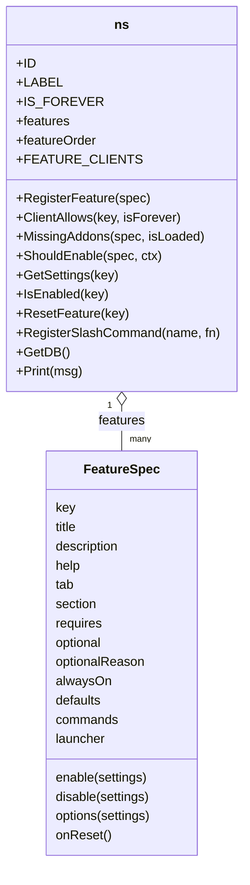

# Deep Dive: Core

## Overview

`Core/Core.lua` is the base of the addon. It creates the shared namespace `ns` (also exported as `_G.KLH`), holds the feature registry and the central client gate, owns settings access through AceDB, drives feature startup, and implements the `/klh` slash command. Every other file reads the namespace through `local _, ns = ...`.

## Responsibilities

- Detect the client: `ns.IS_FOREVER` is true when `GetBuildInfo()` returns a build number from 16000 up to 19999.
- Register features and decide which ones are active on this client with these addons.
- Provide settings (`ns.GetSettings`, `ns.IsEnabled`, `ns.ResetFeature`) on top of the AceDB database inside `KLH_Store`.
- Start features at `PLAYER_LOGIN` and build the options at `ADDON_LOADED`.
- Provide the slash command, its alias notice and the sub-command registry.
- Provide small helpers: `ns.Print`, `ns.AddonLoaded`, `ns.AddonTitle`, `ns.RequiresText`, `ns.StripColors`, `ns.CharData`.
- Switch features that declare `disable` on and off live (`ns.ApplyFeature`, `ns.IsRunning`).

## Architecture

## Key Files

- **`Core/Core.lua`**: everything described here.
- **`.tools/tests/core_test.lua`**, **`slash_test.lua`**: tests for the gate, `ShouldEnable`, `RequiresText` and the slash handler.

## Public Interface

| Function | Behavior |
|---|---|
| `ns.RegisterFeature(spec)` | Asserts `spec.key` (string) and `spec.enable` (function), rejects a duplicate key, returns when `ClientAllows` is false, stores the spec, appends the key to `featureOrder`, and maps each of `spec.commands` (lower case) to the key. |
| `ns.FEATURE_CLIENTS` | Table `key -> "all" / "forever" / "retail"`. Missing key means no client, and `RegisterFeature` prints a one-time developer error for it. Current: `TustUIXPBar = "all"`, the other four (`QuestieRXPSync`, `TurnInRoute`, `WritCratePlanner`, `SoulstoneReminder`) `"forever"`. |
| `ns.Launchers()` | Returns menu entries from features whose enable succeeded and have a `launcher`, in registration order. Each launcher has a string `text` and function `onClick`, validated at registration. |
| `ns.ClientAllows(key, isForever)` | Pure check against `FEATURE_CLIENTS`. |
| `ns.MissingAddons(spec, isLoaded)` | Returns the names in `spec.requires` that `isLoaded` rejects. |
| `ns.ShouldEnable(spec, ctx)` | Client allowed, no missing addons, and `alwaysOn` or `ctx.enabled`. |
| `ns.GetSettings(key)` | Returns `profile.features[key]` (creating it) with a read-through metatable on the spec defaults: a nil key reads the default, and a table default is deep-copied into the settings on first read. Never cache the profile table: a profile switch replaces it. |
| `ns.CharData(key)` | Returns the per-character table `db.char[key]` (creating it). |
| `ns.IsEnabled(key)` | True for `alwaysOn`, else `settings.enabled == true`. |
| `ns.ResetFeature(key)` | Sets `profile.features[key] = nil`. Only `core_test.lua` calls it; the options have no per-feature Reset. |
| `ns.WasEnabledAtLoad(key)` | True if the feature runs: `enable` ran at login (or later through `ApplyFeature`) and `disable` has not run since. |
| `ns.IsRunning(key)` | Clearer alias of `WasEnabledAtLoad`; use it in new code. |
| `ns.ApplyFeature(key)` | Only for specs with `disable`: when `ShouldEnable` (client, addons, toggle) and the running state differ, runs `enable` or `disable` under `xpcall` and updates the running state. Other features are left alone. |
| `ns.RegisterSlashCommand(name, fn)` | Adds a sub-command. `/klh name rest` calls `fn(rest)`. Duplicates assert. |
| `ns.GetDB()` | Returns the AceDB object (created on first use). |
| `ns.RequiresText(missing, titleFn)` | "Requires: A, B" using addon titles with colour codes and textures stripped. |
| `ns.AddonTitle(name)` | `C_AddOns.GetAddOnMetadata(name, "Title")` under `pcall`. |
| `ns.AddonLoaded(name)` | `C_AddOns.IsAddOnLoaded` or the older `IsAddOnLoaded`. |
| `ns.StripColors(s)` | Removes colour codes, texture and atlas tags and extra spaces. |
| `ns.Print(msg)` | Chat line with a green "KLH:" prefix. |

## Implementation Notes

### Startup

The loader frame handles two events. On `ADDON_LOADED` for this addon it calls `ns.RegisterOptions()` once and unregisters. On `PLAYER_LOGIN` it calls `EnableFeatures()` and unregisters. Creating the frame is guarded by `if _G.CreateFrame`, so tests can load the file in plain Lua.

`EnableFeatures` iterates `featureOrder`, builds `ctx = { isForever, isLoaded, enabled }`, and for each feature that passes `ShouldEnable` records `enabledAtLoad[key] = true` and runs `enable(settings)` under `xpcall` with `geterrorhandler()`. The same table is the running state for live features: `ApplyFeature` sets it on `enable` and clears it on `disable`. A spec opts into live switching by declaring `disable = function(settings)`.

### Settings

`Profile()` creates the AceDB store lazily with `{ profile = { features = {} } }` as defaults. AceDB uses the shared `Default` profile for characters without an existing profile mapping; explicit mappings remain unchanged. The `profile` defaults hold only the empty `features` table. `RegisterFeature` builds a read-through metatable from `spec.defaults`, and `GetSettings` attaches it to the settings table, so a new default key reaches existing profiles on the next read.

### Slash command

`SLASH_KLH1 = "/klh"`, `SlashCmdList.KLH = OnSlash`. `OnSlash` splits the message into name and rest. No name opens the options. A known name calls its function. An unknown name whose owner feature is missing addons prints "Title: Requires: ...". Otherwise it prints the list of known commands.

The command `writs` is registered by Writ & Crate Planner from its `enable`. Because `commandOwner` maps `writs` to that feature at registration time, the "Requires" message works even when `enable` never ran.

### Guards for testing

Several pieces check for a global before use (`_G.CreateFrame`, `_G.SlashCmdList`, `_G.C_AddOns`), so `core_test.lua` and `slash_test.lua` can run the file with only the stubs they need.

## Dependencies

- Internal: `Core/Options.lua` (`ns.RegisterOptions`, `ns.OpenOptions`), all modules (consumers).
- External: AceDB-3.0 (through `LibStub`), WoW globals (`GetBuildInfo`, `CreateFrame`, `SlashCmdList`, `geterrorhandler`, `C_AddOns`).

## Testing

- `core_test.lua`: `MissingAddons`, `ShouldEnable` with each client rule (all, retail, forever), the `FEATURE_CLIENTS` table.
- `livefeature_test.lua`: `ApplyFeature` and `IsRunning` for a spec with `disable`: it starts and stops once, a spec without `disable` is never switched live, and losing a required addon stops it.
- `slash_test.lua`: loads `Core/Core.lua`, registers a feature with a command, and checks the handler output for gated and unknown commands.
- `settingsentry_test.lua` and `options_test.lua` also load `Core/Core.lua`.

## Potential Improvements

- `ns.ResetFeature` has no caller outside the tests since the per-feature Reset button was removed; drop it or give it a use.

## Storage envelope and migrations

`KLH_Store` is the only declared SavedVariable. It holds `schemaVersion` outside `database`, the table passed to AceDB. `ns.CharData(key)` accesses `ns.GetDB().char[key]`; character data is separate from profiles and is not reset by profile resets. Version 0 is a hard cut: neither `KLH_DB` nor `KLH_CharDB` is imported.

On first database access, `ns.StorageSchema()` creates the schema and migrates a copy of the entire raw envelope before AceDB initialization. Missing versions mean version 0. Invalid or future versions, missing steps, clone errors and failed steps abort initialization; the original global is replaced only after AceDB initializes successfully. AceDB profile operations are not wrapped or migrated at runtime. The schema engine is independent of addon and AceDB internals.

Future versions require consecutive registered steps and synthetic fixtures with meaningful verifiers in `.tools/tests/storage_contract_test.lua`. The contract checks step and fixture coverage, not migration semantics, fixture completeness or in-game persistence.
