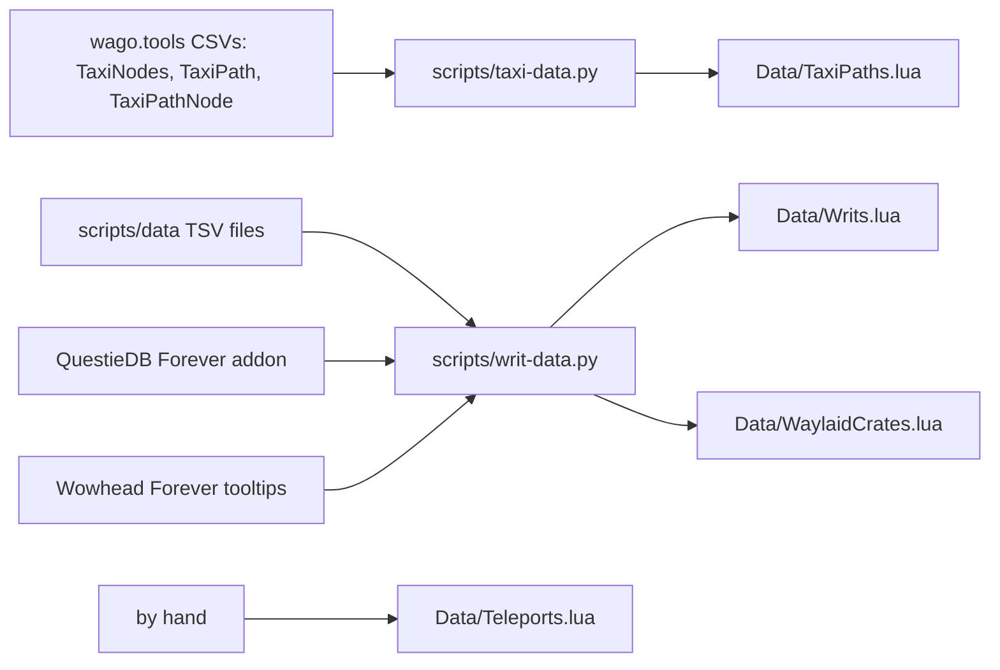

# Deep Dive: Data and Generators

## Overview

The `Data/` folder holds game data as Lua tables. Three files are generated by Python scripts from external sources, and one is written by hand. None of them is documented row by row here. This page describes their shape, who reads them, and how to regenerate them.

All four files start with:

```lua
local _, ns = ...
if ns.IS_FOREVER == false then return end
```

On retail they return before building anything, so no memory is used. `retaildata_test.lua` loads them with `ns.IS_FOREVER = false` and checks that `ns.TaxiPaths`, `ns.Transports`, `ns.Teleports`, `ns.Data.Writs` and `ns.Data.WaylaidCrates` stay nil.

## Responsibilities

- Provide the Forever-only reference data for the Route Planner and the Writ & Crate Planner.
- Keep that data reproducible: generated files carry a header naming their generator and source build, and are written in ASCII.

## Architecture



## Key Files

| File | Producer | Namespace table | Read by |
|---|---|---|---|
| `Data/TaxiPaths.lua` | `scripts/taxi-data.py` | `ns.TaxiPaths`, `ns.Transports` | `RoutePlanner`, `TurnInRouteGraph` (through arguments) |
| `Data/Teleports.lua` | by hand | `ns.Teleports` | `G.Shortcuts`, `ShortcutFacts` |
| `Data/Writs.lua` | `scripts/writ-data.py` | `ns.Data.Writs`, `ns.Data.CampFaction` | `WritCrateState`, `WritCratePlanner`, `TurnInRoute` |
| `Data/WaylaidCrates.lua` | `scripts/writ-data.py` | `ns.Data.WaylaidCrates`, `ns.Data.SealedCrates`, `ns.Data.UnlabeledCrate`, `ns.Data.DeliveryReceipt` | `WritCrateState`, `WritCratePlanner` |
| `scripts/data/writs-forever.tsv` | by hand | input | `writ-data.py` |
| `scripts/data/waylaid-crates.tsv` | by hand | input (`item_id`, `tier`, `kind`) | `writ-data.py` |

## Data Shapes

### `Data/TaxiPaths.lua`

Header: "Generated by scripts/taxi-data.py from build 1.60.1.71037."

- `ns.TaxiPaths[fromNodeID][toNodeID] = { yards, stopSeconds, { x1, y1, x2, y2, ... } }`. The last element is a simplified flight curve in HereBeDragons world coordinates (x is the server y, y is the server x).
- `ns.Transports = { { docks = { { instance, wx, wy, side? }, ... }, legs = { yards, ... }, stops = seconds }, ... }`. 13 entries. `side` is `"A"` or `"H"` when a dock belongs to one faction. Comment in the file: docks in stop order, yards from each dock to the next, and the seconds a full loop stops at docks.

### `Data/Teleports.lua`

`ns.Teleports = { { spellID, name, side, reagent, instance, wx, wy }, ... }`, six mage city teleports (Stormwind, Ironforge, Darnassus, Orgrimmar, Undercity, Thunder Bluff). `reagent` is item 17031 (Rune of Teleportation). The comment gives the source: spell IDs from SpellName build 1.60.1.71037, landings from MaNGOS Zero `spell_target_position`.

### `Data/Writs.lua`

Header: "Generated by scripts/writ-data.py from scripts/data/writs-forever.tsv and QuestieDB Forever 1.1.5 (GPL-3.0), build 1.60.1." Each row of `ns.Data.Writs` (150 rows) has: `tier`, `profession`, `skill`, `writID`, `name`, `questID`, `itemID`, `item`, `qty`, `rep` (75, 125 or 200 by tier), and, where known, `npcID`, `npc`, `friendly` (`"A"`, `"H"` or `"AH"`), `zone`, `mapID`, `x`, `y`. `ns.Data.CampFaction = { Alliance = 2586, Horde = 2587 }`.

### `Data/WaylaidCrates.lua`

- `ns.Data.WaylaidCrates` (30 rows): `itemID`, `name`, `tier`, `kind` (`gathered` or `crafted`), `favor`, `confirmed`, `bundles = { { itemID, name, count }, ... }`.
- `ns.Data.SealedCrates[itemID] = { tier, kind? }` for 15 sealed crates, used to match crates leaving the bags to a Favor gain.
- `ns.Data.UnlabeledCrate = { itemID = 248549, name = "Waylaid Crate", labeled = false }`.
- `ns.Data.DeliveryReceipt = 262902`.

## Generators

### `scripts/taxi-data.py <build> <csv-dir>`

Reads `TaxiNodes.csv`, `TaxiPath.csv` and `TaxiPathNode.csv` (wago.tools exports: `https://wago.tools/db2/<Table>/csv?build=<build>`) and writes `Data/TaxiPaths.lua` (ASCII). It:

- keeps taxi edges between two nodes on one continent that have path nodes;
- sums yards and delay per edge and simplifies the curve with a recursive Douglas-Peucker style `simplify` (tolerance 30 yards);
- finds transports from path nodes that have delays (docks), merges docks closer than 50 yards, computes legs and the loop stop time, and assigns a faction side from the nearby flight masters (`dock_side`, radius 600).

### `scripts/writ-data.py <questie-db-dir> <tooltip-cache-dir> [--fetch] [--build <version>]`

Writes `Data/Writs.lua` and `Data/WaylaidCrates.lua` from the two TSV files, a QuestieDB Forever addon folder (read with a built-in CBOR decoder) and a cache of Wowhead Forever tooltips (`<item_id>.json`, `names.json`). `--fetch` downloads missing tooltips and bundle item IDs first (from `nether.wowhead.com/forever/tooltip/item/` and the Wowhead search suggestions). `--build` sets the game build named in both generated headers; it defaults to `DEFAULT_BUILD` (`1.60.1`) in the script. Item names come from tooltips, else from the TSV. Turn-in NPC, spawn and friendliness come from QuestieDB where it knows the finisher, else from the TSV. The artisan tier is marked unconfirmed for crate Favor (`UNCONFIRMED_TIERS`). It prints a summary like "N writs, M with QuestieDB turn-ins".

`scripts/data/writs-forever.tsv` has comment lines at the top explaining where each column came from. An empty cell means "not recorded yet". Quantities are assumed to be 1 and corrected by hand.

## Implementation Notes

- Never edit a generated file by hand. Change the TSV or the generator and run it again.
- Data licensing: the turn-in data derives from QuestieDB (GPL-3.0), which is why the addon is GPL-3.0.
- The generated files are Lua tables only, with no functions, so loading them costs table construction time on Forever.

## Dependencies

- Internal: read by the modules listed above.
- External for generation: Python 3 standard library, network access for `--fetch`, a QuestieDB Forever checkout and wago.tools CSV exports.

## Testing

- `data_test.lua`: 150 writs, 30 crates, one fully checked writ (quest 94289), at least 131 rows with QuestieDB turn-in data, the camp faction IDs, sealed crate rows, `UnlabeledCrate` and `DeliveryReceipt`.
- `retaildata_test.lua`: nothing is built on retail.
- `routegraph_test.lua` and `routeopts_test.lua`: `#ns.Transports == 13`, `#ns.Teleports == 6`.
- `teleports_test.lua`: the six teleport rows (spell IDs, sides, continents, coordinate bounds).
- `scripts/check.sh` verifies the files are listed in the TOC and ASCII only.

## Potential Improvements

- `Data/Teleports.lua` is hand-written; `teleports_test.lua` cross-checks spells, sides, continents and bounds, not the landing points themselves.
- There is no test that regenerates the data and compares it, because the inputs are not in the repository.
- The generated files embed long single-line rows, which makes diffs hard to read.
