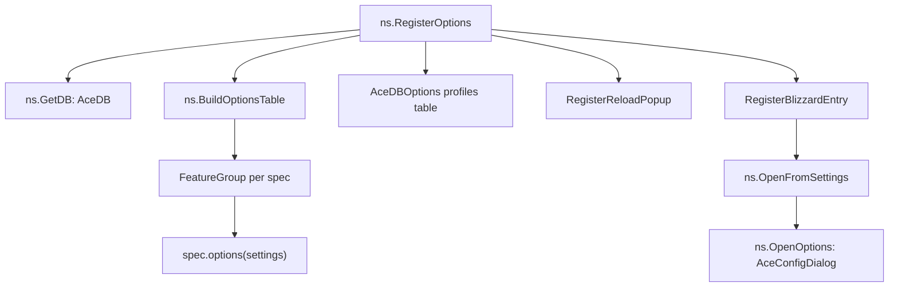

# Deep Dive: Options

## Overview

`Core/Options.lua` turns the feature registry into an AceConfig options tree, opens it with AceConfigDialog, and adds an entry to the Blizzard AddOns settings. The window is a tab group; each feature is a box in its tab, or a header line inside its section's box. Features whose required addons are missing are shown greyed with a "Requires" line.

## Responsibilities

- Build the tabs (General, QoL, Helpers, 3rd Party, Profiles) and one box per feature or per `spec.section`, placed by `spec.tab`; empty tabs are omitted. Each feature starts with its `help` text, kept to one or two sentences.
- Grey out and annotate gated features.
- Add an Enable toggle for features that are not `alwaysOn`. There is no per-feature Reset; resetting is the Profiles tab's "Reset Profile".
- Switch a feature with `disable` live through `ns.ApplyFeature`; ask for a reload when any other switchable feature changes.
- Register the options table, default window size, reload popup and the Blizzard AddOns canvas entry.

## Architecture

## Key Files

- **`Core/Options.lua`**: all of it.
- **`.tools/tests/options_test.lua`**: tab layout, tree building, gating, help and optional lines, toggle.
- **`.tools/tests/livefeature_test.lua`**: live switching of a feature with `disable`.
- **`.tools/tests/settingsentry_test.lua`**: `ns.OpenFromSettings` behavior.

## Public Interface

| Function | Behavior |
|---|---|
| `ns.BuildOptionsTable(features, order, ctx)` | Returns `{ type = "group", name = ns.LABEL, childGroups = "tab", args = { general, qol, helpers, thirdparty, profiles } }`; tabs with no feature on this client are omitted, Profiles (order 1000) is last. `ctx` has `isForever`, `isLoaded`, `title`, `settings`, `profiles`. Features not allowed on this client are skipped. |
| `ns.RegisterOptions()` | Called once on `ADDON_LOADED`. Creates the context, registers profile callbacks, registers the options table with AceConfig, sets the default size 760 x 560, registers the popup and the Blizzard entry. |
| `ns.OpenOptions()` | `AceConfigDialog:Open(ns.ID)`. |
| `ns.OpenFromSettings()` | Runs through `ns.UI.Defer`: closes `SettingsPanel` (`Close(true)`, else `HideUIPanel`, else `Hide`), then opens on the next frame with `C_Timer.After(0, ns.OpenOptions)`. |
| `ns.NotifyOptionsChanged()` | `AceConfigRegistry:NotifyChange(ns.ID)`, to redraw. |

## Implementation Notes

### Tabs

| Tab | Key | Content |
|---|---|---|
| General | `general` | An inline "About" section (addon name, version from `C_AddOns.GetAddOnMetadata`, `/klh` and subcommands, the Blizzard AddOns entry) and the `unavailable` summary of gated features. |
| QoL | `qol` | Features with `tab = "qol"` (Soulstone Reminder on Forever, in the "Dungeons & Raids" section); hidden when empty. |
| Helpers | `helpers` | Features with `tab = "helpers"`, or no `tab` (Turn-in Route, Writ & Crate Planner). |
| 3rd Party | `thirdparty` | Features with `tab = "thirdparty"` (RestedXP Quest Sync, TustUI XP Bar). |
| Profiles | `profiles` | The AceDBOptions table, always last. |

Features keep registration (TOC) order inside a tab.

### Sections

A feature may set `section` (a string). Features of one tab with the same `section` go into one inline group `{ type = "group", inline = true, name = <section> }` keyed `"section_" .. <section with non-alphanumerics removed>`, whose order is the index of its first feature. AceConfigDialog draws every inline group as a box, so a sectioned feature is not nested as a group: `AddToSection` adds a `header` (`<key>_header`, the feature title) and copies the feature's args flat into the section as `<key>_<arg>`, with order `index * 1000 + 1 + order * 10` so features stay in registration order and their own args keep theirs. Features without `section` stay direct children of the tab, one box each. The QoL tab has "Dungeons & Raids" (Soulstone Reminder) and "Interface" (Layer Change Prompt).

The window gets an opaque background (`OpaqueBackground` in `ns.OpenOptions`): a texture on AceGUI's pooled Frame widget, shown while KLH's window is open and hidden on its `OnHide`, so other addons reusing the widget keep the default look.

### Feature group

`FeatureGroup(spec, index, ctx)` returns an `inline = true` group and calls `spec.options(settings)` for its args (an empty table when the spec has no `options`). It then adds:

- `enabled` (order 0.5, full width toggle) only when the spec is not `alwaysOn`. Its setter writes `settings.enabled` (true or nil) and calls `ApplyOrAsk(key)`: `ns.ApplyFeature` for a spec with `disable`, else `AskReload`.
- `help` (order 0.2), the feature's help text, never disabled.
- `optional` (order 0.3) when the spec lists `optional` addons: "Uses X if installed." when all are loaded; when one is missing "Install X for <optionalReason>." if the spec has an `optionalReason` string, else "Uses X if installed (not loaded)." Turn-in Route uses `optionalReason = "waypoints"` for TomTom.

### The "Requires" state

`ns.MissingAddons` runs against `ctx.isLoaded`. If something is missing:

1. Every arg gets `disabled = true` and its description is prefixed (`Prefix`) with "Requires: ...". `Prefix` also handles function descriptions.
2. A `requires` description line is added at order 0.
3. The feature title turns grey (`|cff808080Title|r`), as the box title or, inside a section, the header line. Neither has a hover tooltip, so the `requires` line is the visible marker.
4. `BuildOptionsTable` adds an `unavailable` description to the General tab listing every gated feature and its missing addons.

Addon titles come from `ns.AddonTitle`, with colour codes, texture tags and extra spaces removed by `StripColors` in `Core.lua`.

### Reload logic

A spec with `disable` switches live: its Enable toggle calls `ns.ApplyFeature(key)` and then `ns.NotifyOptionsChanged()`, with no popup, and its toggle text names no reload. For the others, `AskReload(key)` shows the `KLH_RELOAD` popup when `ns.IsEnabled(key)` differs from `ns.IsRunning(key)`. `OnProfileSwap` runs for `OnProfileChanged`, `OnProfileCopied` and `OnProfileReset`; it applies live features, asks for a reload for the other non-`alwaysOn` features, runs `onReset` for running features and refreshes the options. Soulstone Reminder switches live; RestedXP Quest Sync still asks for a reload. The popup sets `FULLSCREEN_DIALOG` strata in `OnShow` because Blizzard resets the strata and the options window sits above `DIALOG`.

### Blizzard AddOns entry

`RegisterBlizzardEntry` is skipped when `Settings.RegisterCanvasLayoutCategory` is missing. It builds a small canvas frame with a title and an "Open Klausi's Little Helpers" button, and registers it as an AddOn category.

## Dependencies

- Internal: `Core/Core.lua` (registry, settings, `ns.AddonLoaded`, `ns.RequiresText`).
- External: AceDBOptions-3.0, AceConfig-3.0, AceConfigDialog-3.0, AceConfigRegistry-3.0, `StaticPopup_Show`, `Settings` API.

## Testing

`options_test.lua` builds a table from stub features on a Forever context. It checks the tab order and placement, the client filter, empty-tab omission, Profiles last, the About text, gated sections (disabled args, prefixed descriptions, grey name, `unavailable` text), the help and optional lines, and the toggle for switchable features. `settingsentry_test.lua` stubs `SettingsPanel`, `HideUIPanel` and `C_Timer` to check that the panel closes before the options open.

## Potential Improvements

- The options table is rebuilt on every AceConfig refresh. That is fine at five features, but `FeatureGroup` calls each `options()` factory every time.
