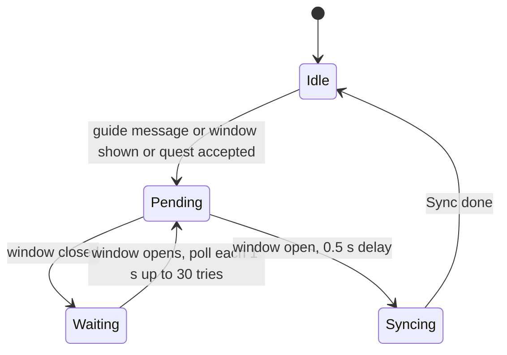

# Deep Dive: RestedXP Quest Sync

## Overview

RestedXP Quest Sync (`Modules/QuestieRXPSync.lua`, feature key `QuestieRXPSync`, title "RestedXP Quest Sync", Forever only) keeps the quest tracker (Questie's, or the default tracker without Questie) in step with the current RestedXP guide. It tracks the quests the guide mentions and untracks all other quests. It changes nothing while the RestedXP guide window is closed.

## Responsibilities

- Learn the current guide when RestedXP sends it.
- Extract the quest IDs the guide uses.
- Track or untrack quests, on guide change, on each newly accepted quest and when the guide window opens.
- Wait for the guide window at login, when RestedXP loads its guide before the window is visible.

## Architecture

## Key Files

- **`Modules/QuestieRXPSync.lua`**: the whole feature.
- **`.tools/tests/questsync_test.lua`**: behavior test with stubbed timers and quest log.
- **`.tools/tests/questsynccap_test.lua`**: the watch limit and the guide-order priority.

## Public Interface

- No `ns.` table: the tests capture the spec through a stubbed `ns.RegisterFeature` and call `spec.enable()`.
- Feature spec: `requires = { "RXPGuides" }`, `optional = { "Questie" }`. It has no options and no defaults. It is not `alwaysOn`, so `ns.ShouldEnable` also needs a saved `enabled` flag (see below).

## Implementation Notes

- **Registration**: the spec in the file has no `alwaysOn = true`. `ns.IsEnabled` therefore reads `settings.enabled`, and `Options.lua` adds an Enable toggle for this feature (order 0.5) that asks for a reload. It has no `disable`, so it is the only feature that still asks for a reload; it is off until the player turns it on and reloads.
- **Enable**: `enable` returns at once if `LibStub("AceEvent-3.0", true)` is missing. AceEvent-3.0 is fetched into `Libs/` from `.pkgmeta`. It imports `QuestieTracker` from `QuestieLoader` (used for `IsTrackedByQuestie`), embeds AceEvent into a private `listener` table, registers `RXP_GUIDE_LOADED` and `RXP_STEP_ACTIVATED` messages, registers `QUEST_ACCEPTED` on a frame, and hooks `RXPFrame` `OnShow` if it exists.
- **Guide parsing**: `GuideQuests(g)` walks `g.steps[*].elements`, keeps elements with tags `accept`, `turnin`, `complete`, `collect`, `daily`, `dailyturnin`, `questgoto` or `questwaypoint` that have a numeric positive `questId`.
- **New guide**: `OnMessage` accepts the guide table from the second or first argument, ignores the same table, stores it and sets `fullSyncPending`. A guide with steps but no recognised quest tags clears the stored quests and prints once "this guide section has no quests".
- **Notices**: `WarnOnce` prints once each when Questie's tracker lacks `IsTrackedByQuestie` (the default tracker state is used) and when no guide window appears after the 30 tries.
- **Window detection**: `GuideOpen()` prefers `RXPV2GuideWindow.frame` (and hooks its `OnShow` once), else `RXPFrame:IsVisible()`.
- **Queueing**: `QueueSync` does nothing unless running with a guide and pending work. If the window is closed, it starts one polling chain (`WaitForWindow`, 1 s interval, 30 tries). If open it schedules `Sync` after 0.5 s. A flag `pending` stops duplicates.
- **Sync**: with `fullSyncPending` it walks `C_QuestLog.GetNumQuestLogEntries()`, skips headers, and calls `SetTracked(id, guideQuests[id] == true)`. Otherwise it only handles quests in `acceptedPending` that are in the log.
- **Tracking**: `IsTracked` asks Questie's tracker when available, else `C_QuestLog.GetQuestWatchType`. `SetTracked` calls `AddQuestWatch` or `RemoveQuestWatch` only when the state differs. A full sync untracks first, then tracks the guide's quests ordered by their next guide step from `RXPCData.currentStep`, stopping at the watch limit (`Constants.QuestWatchConsts.MAX_QUEST_WATCHES`, 25 on Forever); an accepted guide quest is tracked only while there is room.

## Dependencies

- Internal: `ns.RegisterFeature`.
- External: Questie when loaded (`QuestieLoader`, `QuestieTracker`), RestedXP (`RXP_GUIDE_LOADED`, `RXP_STEP_ACTIVATED`, `RXPV2GuideWindow`, `RXPFrame`), AceEvent-3.0, `C_QuestLog`, `C_Timer`.

## Testing

`questsync_test.lua` saves and restores the globals it stubs (`C_Timer`, `C_QuestLog`, `RXPV2GuideWindow`, `RXPFrame`, `wipe`) and uses the fetched AceEvent. It enables the captured spec, sends a guide while the window is hidden and checks that nothing is synced, then shows the window and checks the guide quest is tracked and another quest is untracked (removals before adds). It also covers accepted quests, a guide without quests, the give-up notice and the Questie tracker notice. `questsynccap_test.lua` checks the 25-quest watch limit (3 in the test) and the next-step ordering.

## Potential Improvements

- Guide order uses `RXPCData.currentStep`; if RestedXP renames it, ordering falls back to step 1.
