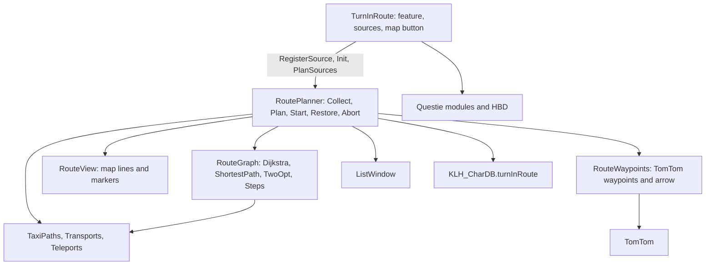

# Deep Dive: Route Planner

## Overview

The Route Planner (feature key `TurnInRoute`, title "Turn-in Route", Forever only) plans the fastest order and way to hand in every ready quest and writ. It is spread over five modules and three data tables:

- `Modules/TurnInRouteGraph.lua`: pure graph and ordering math, `ns.RouteGraph`.
- `Modules/RoutePlanner.lua`: collects stops, builds the travel graph from game data, plans, shows the route list, tracks progress, `ns.RoutePlanner`.
- `Modules/RouteDraw.lua`: map lines and numbered markers, `ns.RouteView`.
- `Modules/RouteWaypoints.lua`: TomTom waypoints, their callbacks and the arrow, `ns.RouteWaypoints`.
- `Modules/TurnInRoute.lua`: the feature itself, the two stop sources, the world map button, options, `ns.TurnInRoute`.
- Data: `ns.TaxiPaths` and `ns.Transports` (`Data/TaxiPaths.lua`), `ns.Teleports` (`Data/Teleports.lua`), `ns.Data.Writs`.

## Responsibilities

- Collect turn-in stops from registered sources and merge stops at the same place.
- Turn the player position, the stops, flight nodes, docks, hearthstone and teleports into a weighted graph.
- Order the stops (travelling salesman) and produce steps per leg (ground, flight, boat, hearth, teleport).
- Show the route: list window, numbered markers and coloured lines on the map canvas.
- Add and manage TomTom waypoints, point the arrow at the next leg.
- Learn the player's real speeds and hearthstone bind. Save and restore the route across a reload.

## Architecture

## Key Files

- **`Modules/TurnInRouteGraph.lua`**: `ns.RouteGraph` (`G`). No game calls.
- **`Modules/RoutePlanner.lua`**: `ns.RoutePlanner` (`RP`).
- **`Modules/RouteDraw.lua`**: `ns.RouteView` (`Attach`, `Init`, `Draw`, `QueueDraw`). Ground legs are solid yellow bows (a quadratic curve bulging 10% of the leg's length to the left of the travel direction, drawn as 16 pieces; purely visual, since the game gives addons no walking path); flights (blue) and boats (teal) are dotted (4 px dot, 5 px gap, kept in screen pixels at any map zoom): flights along the real flight path from `Data/TaxiPaths.lua`, with the dot pattern carried across the path's bends so the spacing stays even, and boats straight from dock to dock. Each dotted segment is clipped to the canvas plus a 50 screen px margin (`V.Clip`), and the dot phase advances over the skipped length, so a zoomed-in map makes only the visible dots and the spacing stays even across the clip edge. Every point converts with its own instance (`GetZoneCoordinatesFromWorldInstance`; both ends of a boat or ground bow use their own), so the Azeroth world map shows both continents in place. Without that HereBeDragons function a point whose instance differs from the map's (`GetWorldCoordinatesFromZone(0.5, 0.5, mapID)`) is off the map. Lines and markers sit on two layers of the map canvas that `RaiseLayers` puts above the highest other map frame (other addons stack their pins up to level ~3000; capped at 9900) when the map ID changes or the map is shown, not on zoom redraws: lines first, the numbered markers just above. The markers are our own frames, scaled to a constant screen size, not shared map pins.
- **`Modules/RouteWaypoints.lua`**: `ns.RouteWaypoints` (`Attach`, `Init`, `Has`, `AddLeg`, `RemoveLeg`, `RemoveRoute`, `ClearAll`, `ArrowTo`, `FollowArrow`, `OnTaxiTaken`).
- **`Modules/TurnInRoute.lua`**: feature registration, `T.ReadyWrits`, `T.WritQuestIds`, `T.MissingQuestieApi`, `T.MenuItems`, `T.Plan`.
- **`Data/TaxiPaths.lua`**: `ns.TaxiPaths[from][to] = { yards, stopSeconds, { x1, y1, x2, y2, ... } }` in HereBeDragons world coordinates, plus `ns.Transports`: 13 entries of `{ docks = { { instance, wx, wy, side? }, ... }, legs = { yards... }, stops = seconds }`.
- **`Data/Teleports.lua`**: six mage city teleports `{ spellID, name, side, reagent = 17031, instance, wx, wy }`.

## Public Interface

### `ns.RouteGraph`

| Function | Purpose |
|---|---|
| `G.FlightTimes(nodes, paths, speed)` | Floyd-Warshall over taxi nodes. Returns `time[i][j]` and `hop[i][j]` (next node). Edge time = `yards / speed + stopSeconds`. |
| `G.FlightHops(nodes, hop, i, j)` | Node IDs along the best flight path. |
| `G.DockRides(transports, side, boatSpeed)` | Docks usable by `side`, each with `rides` to the other docks: half a loop wait plus ride time (60 s added per intermediate dock). |
| `G.GroundEdges(vertices, speed, detour)` | Edges between all vertices in the same instance, time = straight distance x detour / speed. |
| `G.Dijkstra(vertices, edges, source)` | Returns `dist`, `prev`, `via`. Binary heap (`HeapPush`/`HeapPop`), ties popped by lowest vertex index. |
| `G.Steps(vertices, prev, via, source, target)` | Rebuilds the chain, merging consecutive ground steps. |
| `G.ShortestPath(cost, keys)` | Visit order and total: exact bitmask DP for up to 12 keys, else greedy, `G.TwoOpt`, then Or-opt. |
| `G.TwoOpt(cost, path, total)` | 2-opt improvement of `path` in place. Each reversal's cost change is computed incrementally; near the acceptance threshold it re-sums the path so rounding never changes a decision. Returns the new total. |
| `G.PathCost`, `G.Reverse` | Helpers. |
| `G.Shortcuts(facts, opts)` | Hearth (30 s) and known, reagent-backed teleports (15 s) as jump entries. |

### `ns.RoutePlanner`

| Function | Purpose |
|---|---|
| `RP.RegisterSource(key, { title, order, collect })`, `RP.Sources()` | Source registry, sorted by `order` then key. |
| `RP.Collect(keys)` | Runs sources under `pcall`. Returns merged stops, unknown count, quest count, failed titles. |
| `RP.MergeStops(lists)` | Merges by `mapID:x:y` (rounded to 0.001). Does not mutate the inputs. |
| `RP.Plan(stops, { hearth, teleports })` | Returns `{ count, unknown, routed, unreachable, route, total, start }`. |
| `RP.PlanSources(keys, settings)` | Collect, plan, start, and return `message, started`. |
| `RP.Start(plan, { waypoints })`, `RP.WaypointSteps(mode, hasOldRoute)` | Install a route and manage TomTom. |
| `RP.Restore()`, `RP.RestoreKeep(questIds, isCompleted)` | Restore a saved route. |
| `RP.Abort()`, `RP.Active()`, `RP.Init(opts)` | Control and setup (`opts.hbd`, `opts.onRefresh`). |

### `ns.TurnInRoute`

`T.ReadyWrits(writs, bagCount, onQuest)`, `T.WritQuestIds(writs)`, `T.MissingQuestieApi(modules)` (names the first missing Questie module or function, nil when complete), `T.MenuItems(sources, active)`, `T.Plan(keys)`.

## Implementation Notes

### Sources

`TurnInRoute.enable` needs `QuestieLoader`, `WorldMapFrame`, and the modules `QuestieDB`, `ZoneDB`, `DistanceUtils` and `HBD`; if `T.MissingQuestieApi` finds something missing it prints that route planning is off and stops. It registers two sources, `quests` (order 1) and `writs` (order 2), calls `RP.Init`, and hooks `WorldMapFrame` `OnShow` to create the button (once, through `Krowi_WorldMapButtons-1.4`, skipped when that library is missing).

- `quests`: for each quest log entry that is not a header, not a writ quest and complete according to Questie, take the finisher's nearest spawn and convert the area ID with `ZoneDB:GetUiMapIdByAreaId`. Stops get `quests = { title }` and `questIds = { id }`.
- `writs`: a writ is ready when its writ item is in the bags (or its quest is in the log) and the requested item count is in the bags. Writs without `mapID` count as unknown.

### Travel graph (`TravelGraph` in `RoutePlanner.lua`)

Vertices are: start, stops, taxi nodes per continent, docks, shortcut landings. Speed constants: walking 7 yd/s as the floor, ground detour 1.3, taxi default 32, boat 20, flight overhead 20 s. Ground speed is `max(7, run speed, saved mount speed)`.

- Continents come from the start, the stops and the shortcut landings (`ContinentOf`, `ContinentAt`, cached per instance).
- Flight nodes: `C_TaxiMap.GetTaxiNodesForMap(continent)`, undiscovered nodes and the other faction's nodes dropped. Each node gets a zone map position through `ZonePosition`.
- Edges exist between every pair of vertices in one instance (ground), between taxi nodes with a known path (flight), between docks (boat), and from the start vertex to each shortcut landing (hearth or teleport).

### Ordering

`RP.Plan` runs `G.Dijkstra` from every stop vertex (and the start) to get a cost matrix, keeps the stops reachable from the start, and calls `G.ShortestPath`. Dijkstra uses a binary heap. With 12 or fewer vertices (start included) `ShortestPath` uses an exact bitmask DP (`Exact`). Otherwise it builds a greedy path and improves it with `G.TwoOpt` (incremental cost change) and Or-opt (segments of 1 to 3). Unreachable stops are counted, not routed.

### Learning

- `OnTakeTaxiNode` (hooked on `TakeTaxiNode`) sums yards and stop delays over the route legs from `ns.TaxiPaths`, waits up to 20 half-second ticks for `UnitOnTaxi`, and `OnLanded` computes the speed. Flights under 20 s or speeds outside 15 to 80 yd/s are ignored. The saved `taxiSpeed` is a running average of up to 10 samples.
- `RecordMountSpeed` keeps the last 5 run speeds seen while mounted (`mountSamples`) and saves their maximum as `mountSpeed`.
- `OnHearthBound` (event `HEARTHSTONE_BOUND`) saves the bind position and name. `HearthReady` checks the bind still matches `GetBindLocation()`, a hearthstone (item 6948) is in the bags and its cooldown is over.
- `Plain()` drops secret values before they are compared.

### Showing and progress

Each leg has `number`, `stop`, `steps`, `transit` (TomTom waypoints for flight and boat steps) and an optional `uid` (stop waypoint). `Refresh` writes the window entries, saves the route, redraws and points the TomTom arrow at the first open leg. Row click aims the arrow at that leg, Ctrl+click drops the leg (`DropLeg`). Lines use `CreateLine` on a frame over the map canvas and are redrawn after a map change, canvas scale change or frame resize (queued with `C_Timer.After(0, ...)` in `RouteView.QueueDraw`). Markers are circle-masked frames placed with `HereBeDragons-Pins-2.0` and clustered when they overlap (labels like `1-3` or `1/4`).

### Options (`TurnInRoute` feature)

Defaults `useHearth = false`, `useTeleports = false`, `waypoints = "add"`. Options: Use Hearthstone, Use Mage Teleports, and a TomTom waypoint mode select (add or replace) that is disabled when TomTom is not loaded.

## Dependencies

- Internal: `ns.RouteGraph`, `ns.RouteView`, `ns.RouteWaypoints`, `ns.CreateListWindow`, `ns.UI`, `ns.GetSettings`, `ns.WritState.BagCounts` (optional), `ns.Data.Writs`, `ns.Teleports`.
- External: Questie (`QuestieDB`, `ZoneDB`, `DistanceUtils`, `HBD`), Krowi_WorldMapButtons-1.4, TomTom (optional), RestedXP (paused through `SlashCmdList.ACECONSOLE_RXP`), WoW map, taxi, quest, item, spell book APIs.

## Testing

- `routegraph_test.lua`: `FlightTimes`, `FlightHops`, `DockRides`, `GroundEdges`, `Dijkstra`, `Steps`, `ShortestPath`, `PathCost`, `Reverse`, and `#ns.Transports == 13`.
- `routeopts_test.lua`: `G.Shortcuts` for hearth and teleports, `#ns.Teleports == 6`.
- `teleports_test.lua`: spell IDs, sides, continents and coordinate bounds of `Data/Teleports.lua`.
- `routeplanner_test.lua`: `MergeStops`, `RegisterSource`, `Sources`, `Collect`, `WaypointSteps`, `Start`, `RestoreKeep`.
- `routedraw_test.lua`: a ground step is a joined solid bow from stop to stop that bulges 10% at its middle, its end converted with the end's instance; a boat step is dotted; a flight becomes evenly spaced dots no longer than the dot length, covering about 4 of every 9 units of the path, and no dot cuts across a bend; a flight mostly off the canvas makes only the dots inside the margin, evenly spaced across the skipped part; layers are raised on a map change or show, not on a redraw or zoom; the fallback conversion drops points of another instance; markers keep their screen size and offsets at canvas scales 2 and 0.5.
- `routeevents_test.lua`: `RoutePlanner` with the real `RouteDraw` and `RouteWaypoints`: TomTom callbacks, one waypoint per transit step, the arrow, partial turn-ins and removed legs.
- `routequestie_test.lua`: `TurnInRoute` with and without a complete Questie API (`T.MissingQuestieApi`).
- `routewiring_test.lua`: stubs the game API and HereBeDragons, then covers restore with and without TomTom, `RestoreKeep`, `PlanSources` messages, the hearth and cooldown rules and `Plan` with a stubbed world.
- `routeheap_test.lua`: heap `Dijkstra` and incremental `G.TwoOpt` against the old scan and full-recompute versions on 200 random inputs each.
- `turnin_test.lua`: `T.ReadyWrits`, `T.WritQuestIds`, `T.MenuItems`.
- `retaildata_test.lua`: no flight or teleport data on retail.

The map drawing and markers have no tests.

## Potential Improvements

- Time estimates for boats assume half the loop as waiting time. Real schedules are not read.
- Teleport landings are only mage city teleports. Other sources (portals, engineering items) are not modelled.
- `ns.Transports` is a static list of 13 transports and is not tied to the client build except through the generator.
