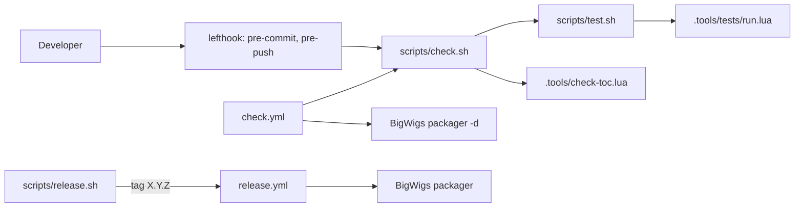

# Deep Dive: Tooling and Tests

## Overview

Development tooling lives in `scripts/` (Bash and Python), `.tools/` (Lua helpers and tests), `lefthook.yml` (git hooks), `.github/workflows/` (CI and release), `.pkgmeta` (packaging) and `.luacheckrc` (lint rules). None of it ships in the addon package: `.pkgmeta` ignores `.github`, `.luacheckrc`, `.tools`, `docs`, `lefthook.yml`, `README.md`, `CONTRIBUTING.md`, `renovate.json5`, `scripts` and `tests`, `AGENTS.md`, `CLAUDE.md`, plus editor and agent folders and dotfiles.

## Responsibilities

- Validate every change locally and in CI (syntax, TOC coverage, tests, lint, ASCII).
- Copy the addon into the game folders for manual testing, with a usable version string.
- Read in-game errors without opening the game.
- Look up Blizzard UI source.
- Cut a release and publish it only after CI passes.

## Architecture

## Key Files

| File | Purpose |
|---|---|
| `scripts/check.sh` | Full local check. Exit status is 1 if any step failed. |
| `scripts/test.sh` | Runs every `.tools/tests/*_test.lua` through `lua5.1 .tools/tests/run.lua`. |
| `scripts/sync.sh` | Copies the addon into the live AddOns folders. |
| `scripts/errors.sh` | Prints `!BugGrabber` errors. |
| `scripts/ui-source.sh` | Clones and searches Blizzard's UI source, and fetches the WoW API annotations for the editor. |
| `scripts/release.sh` | Tags and pushes a release. |
| `scripts/taxi-data.py`, `scripts/writ-data.py` | Data generators (see [Data and Generators](<Data and Generators.md>)). |
| `.tools/check-toc.lua`, `.tools/errors.lua` | Lua helpers for `check.sh` and `errors.sh`. |
| `.tools/tests/run.lua` and 33 `*_test.lua` files | Test runner and tests. |
| `.luarc.json` | LuaLS settings: Lua 5.1, the addon and test globals, and `~/.local/share/wow/vscode-wow-api/Annotations` as library. |
| `lefthook.yml` | Git hooks. |
| `.github/workflows/check.yml`, `release.yml` | CI and release. |
| `.luacheckrc` | `std = "lua51"`, no line limit, WoW globals, per-file overrides. |

## Public Interface

### `scripts/check.sh`

Steps, all run even after a failure:

1. `luac5.1 -p` (or `luac`, override with `LUAC`) on every Lua file from `git ls-files --cached --others --exclude-standard`, excluding `Libs/`.
2. `lua5.1 .tools/check-toc.lua KlausisLittleHelpers.toc`: every TOC path exists, and every tracked `.lua` file outside `scripts/`, `tests/`, `Libs/`, `.tools/` is listed.
3. `scripts/test.sh`.
4. `luacheck --no-color -q .` if installed, else "luacheck not installed, skipped".
5. A grep for non-ASCII bytes in `*.lua`, `*.toc`, `*.sh`, `*.py` and `*.md` (excluding `Libs/`).

### `scripts/test.sh`

`.tools/tests/run.lua` loads each test file into its own environment. The environment inherits `_G` and adds `eq(a, b, msg)`, `ok(cond, msg)`, `find(list, field, value, pred)`, `has(...)`, a fresh `ns = { Data = {} }`, and `addon(path)`, which runs a repository file with `("KlausisLittleHelpers", ns)` as its varargs. Failures print `FAIL ...` to stderr; every failing assertion in a file is reported, then the runner exits with 1. Success prints `PASS <files> files, <assertions> assertions`.

### `scripts/sync.sh retail|forever|all [--dry-run]`

- `WOW_DIR` (default `/mnt/stuff/Games/World of Warcraft`) holds `_retail_` and `_forever_`. The target is `<WOW_DIR>/<flavor>/Interface/AddOns/KlausisLittleHelpers`.
- Exclusions: every dotfile, `*.zip`, and each path in the `.pkgmeta` `ignore:` list (read with `sed`).
- `rsync -a --delete --delete-excluded --itemize-changes`.
- **Version token**: the TOC contains `## Version: @project-version@`. The BigWigs packager fills it at release time. `sync.sh` fills it for the local copy only: `git describe --tags --match '[0-9]*.[0-9]*.[0-9]*' --dirty` if there is a tag, else `dev-<short sha>` with `-dirty` when the tree differs from `HEAD`. It runs `sed -i` on the copied TOC, never on the repository file.
- A dry run changes nothing and prints "would be version X".
- Afterwards the player types `/reload` in game.

### `scripts/errors.sh [retail|forever] [pattern] [--all-sessions]`

Finds `<WOW_DIR>/<flavor>/WTF/Account/*/SavedVariables/!BugGrabber.lua` and runs `.tools/errors.lua` on each. The default pattern is `KlausisLittleHelpers`. Without `--all-sessions` it only prints errors of the latest session (`BugGrabberDB.session`). Output: counter, session, UTC time, message, stack, and a final count. It needs `!BugGrabber` installed and a `/reload` so the SavedVariables are written.

### `scripts/ui-source.sh update | grep <regex> [live|forever]`

`update` clones or refreshes `https://github.com/Gethe/wow-ui-source` (branches `live` and `forever`, depth 1) into `~/.local/share/wow/` (override with `WOW_UI_SOURCE`), and `https://github.com/Ketho/vscode-wow-api` into `~/.local/share/wow/vscode-wow-api`, whose `Annotations` folder `.luarc.json` uses for WoW globals. `grep` searches `*.lua` and `*.xml` under `Interface/` and shows the first 200 hits.

### `scripts/release.sh major|minor|patch|X.Y.Z`

1. Must be on a branch. Pulls fast-forward only when the tree is clean, else checks that the branch is not behind `origin`.
2. Offers to commit remaining changes as a release prep commit (default message "chore: prepare release").
3. Re-checks `origin` and computes the next version from the latest `X.Y.Z` tag (SemVer without a `v` prefix, starting at `0.0.0`; a `v` given on the command line is dropped). Refuses an existing local or remote tag.
4. Asks for confirmation, creates an annotated tag, and pushes the branch and the tag.
5. It prints the Actions URL. The workflow publishes later.

## CI and Release Workflows

### `check.yml` (name `check`)

Triggers: push to `main`, pull requests, manual. `contents: read`, concurrency per ref (cancels older runs except on `main`).

- Job `check`: `ubuntu-26.04`, installs `lua5.1`, `lua-check`, `rsync`, `shellcheck`, runs `scripts/check.sh`, then shellcheck, actionlint and gitleaks. `check.sh` fails when luacheck is missing and `CI` is set.
- Job `package` (needs `check`): checks out with full history, runs the BigWigs packager with `-d` (no upload) and uploads `.release/*.zip` as an artifact kept 14 days.

Actions are pinned by commit SHA.

### `release.yml` (name `release`)

Triggers: `workflow_run` of `check` completed, a pushed tag `X.Y.Z`, manual. Runs are serialized (`concurrency: release`, no cancel).

- Job `gate`: runs for a successful `push` check run (or any tag or manual run). It finds the latest `check` run for the commit through `gh api` and requires `completed` and `success`. If CI is still running it defers to the later `workflow_run` trigger (except for manual runs). It then looks for an `X.Y.Z` tag on `HEAD`, and skips if no tag exists or a GitHub release for it already exists.
- Job `release`: runs only when `gate` found a tag. It uses the `release` environment, `contents: write`, and the BigWigs packager with the secrets `CF_API_KEY`, `WOWI_API_TOKEN`, `WAGO_API_TOKEN` and `GITHUB_OAUTH` (the GitHub token).

### `lefthook.yml`

- `pre-commit` (parallel): `gitleaks git --staged`, `luac5.1 -p` on staged Lua (not `Libs/`), `luacheck` on staged Lua, `scripts/test.sh`, the TOC check, `shellcheck -S warning` on `scripts/*.sh`, `yq` parse of staged YAML, `actionlint` on workflow files (skipped when not installed).
- `pre-push`: `scripts/check.sh`.

Run `lefthook install` once per clone. Do not skip hooks with `--no-verify` (project rule).

## Implementation Notes

- **Lint config**: `.luacheckrc` excludes `Libs/**` and `.release/**`, sets `max_line_length = false`, `unused_args = false`. Read-only WoW globals are listed, and the addon's own globals are `KLH`, `KLH_DB`, `KLH_CharDB`, `SlashCmdList`, `SLASH_KLH1..3`. Test files may use `eq`, `ok`, `find`, `has`, `addon` and the global `ns`.
- **Why tests stub globals**: tests that touch game APIs save the globals they replace and restore them at the end, because each test file runs in an environment that falls back to `_G`.
- **Test inventory** (33 files), by area: Core (`core`, `slash`, `options`, `settingsentry`, `ui`, `listwindow`, `livefeature`), routes (`routegraph`, `routeheap`, `routeopts`, `routeplanner`, `routewiring`, `routeevents`, `routequestie`, `turnin`, `teleports`), writs (`cover`, `plan`, `tiebreak`, `candidates`, `observe`, `planner`, `plannerevents`, `writlearner`), RestedXP Quest Sync (`questsync`, `questsynccap`), Soulstone Reminder (`soulstone`, `soulstonewiring`, `soulstonecomms`), TustUI XP bar (`xpbar`), data (`data`, `retaildata`), structure (`standalone`).
- `standalone_test.lua` reads the TOC and fails if any Core, Modules or Data file mentions `EllesmereUI`, `EUI.` or `EUI_CLIENT_BLOCKED`, except `Modules/TustUIXPBar.lua`.
- `renovate.json5` configures dependency updates.

## Dependencies

- Required locally: `bash`, `lua5.1`, `luac5.1`, `git`, `rsync` (sync).
- Optional: `luacheck`, `lefthook`, `gitleaks`, `shellcheck`, `yq`, `actionlint`, `python3` (generators), `gh` (release workflow runs it in CI).
- CI: GitHub Actions, BigWigs packager.

## Testing

The tests themselves are described per component in the other deep-dive files. CI runs the same `scripts/check.sh` as the pre-push hook.

## Potential Improvements

- Frame code (map markers, ListWindow rows) is only covered through pure helpers such as `ns.ListWindowLayout`; a fake `CreateFrame` could cover the rest.
- `sync.sh` and `errors.sh` default to a fixed `WOW_DIR` path on one machine. Both print an error when the folder or SavedVariables are missing, but the path itself is not discoverable.
