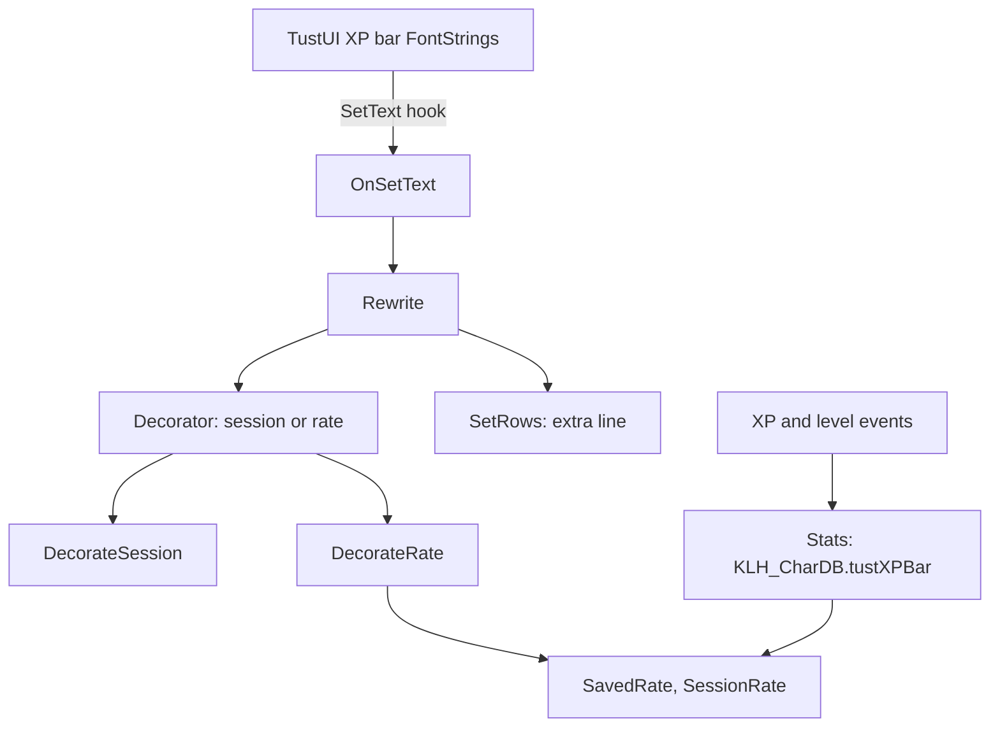

# Deep Dive: TustUI XP Bar

## Overview

`Modules/TustUIXPBar.lua` (feature key `TustUIXPBar`, title "TustUI Enhanced XP Bar") adds two things to the text on TustUI's Enhanced XP Bar: the XP gained this session behind the session time, and an all-time XP/hour rate with its time to level. It is the only feature that loads on both retail and Forever, and the only one that uses EllesmereUI helpers. It requires both `Tust_EUI` and `EllesmereUI` and is `alwaysOn`.

The file starts with `if EUI_CLIENT_BLOCKED then return end` and reads `local EUI = EllesmereUI`. `.luacheckrc` declares those two globals for this file only, and `standalone_test.lua` skips this file when it checks that other files do not use EllesmereUI.

## Responsibilities

- Hook the font strings of `TustUIEnhancedXPBarFrame` and rewrite two of them.
- Add the session XP in the form "(1.2K XP)".
- Save XP and time per character (`KLH_CharDB.tustXPBar`) and compute an all-time rate.
- Show an extra row for "All-Time" when the source is "Both", colouring the session rate against the saved one.
- Offer options and a reset for the saved stats.

## Architecture

## Key Files

- **`Modules/TustUIXPBar.lua`**: the feature.
- **`.luacheckrc`**: file-specific read globals `EllesmereUI`, `EUI_CLIENT_BLOCKED`.
- **`.tools/tests/standalone_test.lua`**: asserts the other Core, Data and Modules files are free of EllesmereUI references, and skips this one.
- **`.tools/tests/xpbar_test.lua`**: behavior test with stubbed TustUI and EllesmereUI.

## Public Interface

No `ns.` table. The feature spec provides:

- `defaults = { showSessionXP = true, rateSource = "session" }`.
- `options`: Show Session XP (toggle), XP/Hour Duration (select: Session, All-Time, Both), a description with the saved totals (`StatsLabel`), and a "Reset Saved Stats" button with a confirm.
- `onReset = Refresh`, so a profile switch, copy or reset redraws the bar text.

## Implementation Notes

- **Enable**: returns early without `_G.TustEUI`. It seeds `lastXP`/`lastMaxXP`, calls `Bank()`, hooks `TustEUI.ApplyEnhancedXPBarSettings` (if it is a function) to re-attach after TustUI rebuilds its bar and calls `Attach()`; without that function it retries `Attach` up to 10 times, 3 s apart (`AttachWhenReady`). It registers `PLAYER_XP_UPDATE`, `PLAYER_LEVEL_UP`, `PLAYER_LOGOUT`, `PLAYER_ENTERING_WORLD`, `UPDATE_EXPANSION_LEVEL` and `MAX_EXPANSION_LEVEL_UPDATED`.
- **Hooking**: `HookStrings(frame)` walks regions and children recursively and uses `hooksecurefunc(region, "SetText", OnSetText)` on each font string once. `original[fs]` remembers the last text TustUI set, so `Refresh()` can redo the rewrite after an option change. A `rewriting` flag stops the hook from reacting to the addon's own `SetText`.
- **Which text is which**: TustUI reparents its texts in `pairs()` order, so position is not reliable. `Decorator(text)` matches the text prefix of the localized templates "Time this session: %s" and "Leveling in: %s (%s XP/Hour)" (`PrefixOf` uses `EUI.L`).
- **Saved stats**: `Stats()` creates `KLH_CharDB.tustXPBar = { xp, time }`. `CountXP` adds gained XP on `PLAYER_XP_UPDATE`, handling a level-up wrap with the old maximum. `Bank(level)` adds the elapsed live time to `time` and restarts the timer only while the player is leveling (below the max level and with a non-zero XP maximum). `MaxLevel()` uses `GameRulesUtil.GetEffectiveMaxLevelForPlayer` when present, else `GetMaxLevelForPlayerExpansion`.
- **Rates**: `SavedRate` = `ceil(xp / (seconds / 3600))`, 0 if XP is 0 or time is under 5 s. `SessionRate` uses TustUI's own state (`TustEUICharacterDB.enhancedXPBar`: `startTime`, `gainedXP`).
- **Rows**: for "Both", `SetRows` places the second text in an extra font string cloned from the original (same font, colour, shadow, justification). It sits above the bar text when the original is anchored at a TOP point, below otherwise, and the session row always stays on top.
- **Colours**: session rate vs saved rate with tolerance 0.15: white near, red (`ffff5a5a`) below, green (`ff5aff7a`) above.
- **Number format**: `ShortNumber` follows TustUI: `EUI.AbbreviateNumberFixed` (or `AbbreviateNumber`) on Forever, "K" and "M" suffixes on retail.
- **Errors**: the decoration runs under `xpcall(..., geterrorhandler())`; on failure the original text stays.

## Dependencies

- Internal: `ns.RegisterFeature`, `ns.GetSettings`, `ns.IS_FOREVER`.
- External: Tust_EUI (`TustEUI`, `TustUIEnhancedXPBarFrame`, `TustEUICharacterDB`), EllesmereUI (`EUI.L`, `EUI.Lf`, `EUI.AbbreviateNumber[Fixed]`), AceConfigRegistry (to redraw the options).

## Testing

`xpbar_test.lua` loads the file with stubbed TustUI, EllesmereUI and `KLH_CharDB`. It checks the retry attach when no Apply hook exists, the "Saved: ..." label formats, the level-up wrap in `CountXP`, the session colour rule (white within 15 percent of the saved rate, red below, green above), `requires = { "Tust_EUI", "EllesmereUI" }` and that a missing EllesmereUI leaves the stats label empty. `standalone_test.lua` guarantees that the rest of the addon stays free of EllesmereUI references.

## Potential Improvements

- Matching by translated template prefix breaks if TustUI changes a string. A version check or a fallback match would help.
- The stats cannot be split by character level range or exported.
