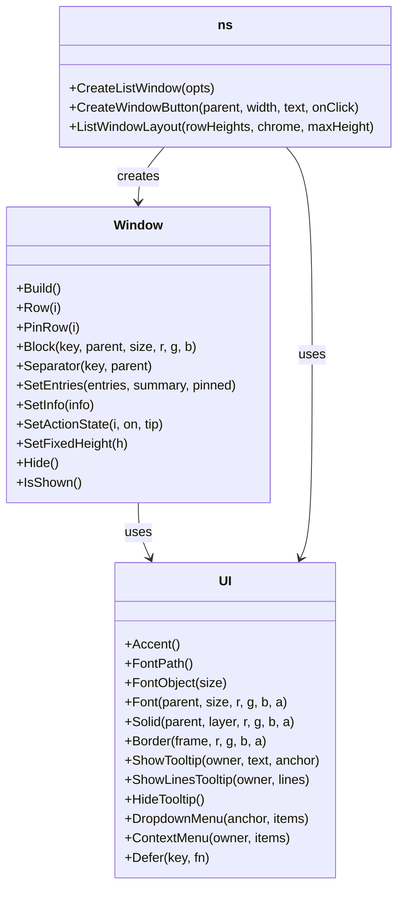

# Deep Dive: UI and ListWindow

## Overview

Two small files provide the shared look and widgets of the addon. `Core/UI.lua` is the helper table `ns.UI`. `Core/ListWindow.lua` builds on it to make the draggable, scrollable list window used by the Turn-in Route and the Writ & Crate Planner, plus a small button widget and the pure height calculation `ns.ListWindowLayout`.

## Responsibilities

- A single accent colour and font choice (`UI.Accent()`, `UI.Font`, `UI.FontObject`); with EllesmereUI installed and its third-party skinning on, `Core/Skin.lua` swaps in EUI's accent and skins list windows with `S.Shell` (and buttons, edit boxes, panels close buttons, checkboxes and dropdowns with EUI's matching skins (`UI.SkinCheckbox`, `UI.SkinDropdown`)).
- Flat texture and border helpers (`UI.Solid`, `UI.Border`).
- Plain-text and line-list tooltips, a dropdown menu, and a context menu with a fallback for clients without `MenuUtil`. `UI.CloseMenus`, `UI.IsMenuOpen` and `UI.OnMenuClosed` manage menu state. A dropdown toggles closed when its owner is clicked again and displays at most 20 rows at once.
- Shared number and money formatting (`UI.FormatNumber`, `UI.FormatMoney`).
- Combat-safe deferral (`UI.Defer`).
- A list window with header, buttons, an info icon, a summary and pinned rows above the list, rows, action buttons, remembered position, a maximum height of 60% of the screen and a mouse-wheel scroll area for longer lists.

## Architecture

## Key Files

- **`Core/UI.lua`**: `ns.UI`.
- **`Core/Skin.lua`**: the optional EllesmereUI skin (`UI.Accent` override, `UI.Skinned`, `UI.SkinWindow`, `UI.SkinButton`, `UI.SkinEditBox`, `UI.SkinPanel`, `UI.SkinCloseButton`).
- **`Core/ListWindow.lua`**: `ns.CreateListWindow`, `ns.CreateWindowButton`, `ns.ListWindowLayout`.
- **`.tools/tests/ui_test.lua`**: tests `UI.Defer`, `UI.Accent` and `UI.SetArrowTexture`.
- **`.tools/tests/listwindow_test.lua`**: tests `ns.ListWindowLayout`, the row icon (`ns.ListWindowFillRow`) and the column alignment (`ns.ListWindowAlignIcons`).

## Public Interface

### `ns.UI`

| Function | Behavior |
|---|---|
| `UI.FormatNumber(n)` | Rounds to the nearest integer and groups digits with commas. |
| `UI.FormatMoney(copper)` | Rounds copper; displays gold and rounded silver from 1g, silver and copper below, or copper alone. |
| `UI.Accent()` | Returns `0.05, 0.82, 0.62`. |
| `UI.FontObject(size)` | The Blizzard font object for that size: `GameFontHighlightSmall` up to 11, `GameFontHighlight` up to 13, `GameFontHighlightMedium` up to 15, else `GameFontHighlightLarge`. |
| `UI.Font(parent, size, r, g, b, a)` | Creates an OVERLAY font string with that size's font object and colour. |
| `UI.Solid(parent, layer, r, g, b, a)` | A colour texture. |
| `UI.Border(frame, r, g, b, a)` | Four 1 px edge textures. Returns an object with `SetColor`. |
| `UI.ShowTooltip(owner, text, anchor?)` / `UI.HideTooltip()` | `GameTooltip` with wrapped text, anchored at `anchor` (default `ANCHOR_RIGHT`). |
| `UI.ShowLinesTooltip(owner, lines)` | `GameTooltip` from `{ left, right?, label?, header?, gold?, grey?, warn? }` lines; scaled down when taller than 95% of the screen. |
| `UI.DropdownMenu(anchor, items)` | Our own menu below `anchor`, exactly as wide; `items = { { text, right?, onClick }, ... }`. |
| `UI.ContextMenu(owner, items)` | `items = { { text, isActive?, title?, onClick }, ... }`. Uses `MenuUtil.CreateContextMenu`: plain buttons, radio entries only for items with `isActive`, titles for `title`; else a hand-made fallback menu. |
| `UI.Defer(key, fn)` | Runs `fn` now out of combat. In combat it stores the latest `fn` per key and runs all on `PLAYER_REGEN_ENABLED` under `xpcall`. |

### `ns.CreateListWindow(opts)`

`opts`: `name` (frame name), `title`, `key` (feature key whose settings keep the position), `width` (default 250), `hint` (default row tooltip), `onClick(data)`, `onCtrlClick(data)`, `buttons` (header buttons, laid out right to left), `top(frame, width, y) -> height` (controls under the header), `actions` (bottom row of equal-width buttons).

The returned object has `SetEntries(entries, summary, pinned)`, `SetInfo(info)`, `SetActionState(i, on, tip)`, `SetFixedHeight(h)`, `Row(i)`, `PinRow(i)`, `Hide()`, `IsShown()` and `Build()`.

### `ns.ListWindowLayout(rowHeights, chrome, maxHeight)`

Pure. `rowHeights` are the heights of the rows (each plus a 4 px gap), `chrome` is all fixed height around them. Returns `height, needsScroll`: the full height when it fits `maxHeight` (or `maxHeight` is nil or not positive), else `max(maxHeight, chrome + 40)` and `true`.

- `entries = { { text, right?, icon?, header?, indent?, selected?, button?, data?, tooltip?, tooltipLines? }, ... }`: `right` is a right-aligned column (the left text then stays on one line), rows use Auctionator's fonts (`ChatFontNormal` for the text, as its item name cells, and `PriceFont` for the right column, as Blizzard's money display), so they match the auction house lists; `itemID` shows the game's item tooltip on hover (`UI.ShowItemTooltip`, with `tooltip` as a hint below it), `icon` (`{ file, r, g, b }`) is a 12 px texture tinted with `SetVertexColor`, left of the right column (a texture, since inline texture markup does not render on Forever); `extra` is a grey second column right of `right` (the planner puts rep, Favor and zone counts there); after filling, `AlignIcons` lines up the pinned rows and the list rows together: it re-measures the right and extra texts of every row that has either (`row.hasRight`, set by the fill, so a font still reporting 0 at fill time is not skipped), makes one extra column as wide as its widest entry, puts the right texts left of it on one edge, and the icons in one column left of the widest right text; a button row clears its column fields, `header` rows take the accent colour and 8 px of space above, `indent` shifts the left text 10 px. `summary` is `{ text, tooltip? }`.
- An empty list without a summary or pinned rows hides the window.
- `frame` is available after `Build()`. `SetEntries` builds on first use. The planner calls `Build()` itself so it can anchor the frame.

## Implementation Notes

- **Frame**: strata `HIGH` and `SetToplevel(true)`, so unit frames and other `MEDIUM` UI stay below it; an opaque backdrop with a faint 1 px border, replaced by EUI's `S.Shell` when skinned.
- **Layout**: the summary sits above the scroll area with a separator line under it; without a summary, a window with top controls still gets the separator under them. `SetEntries` stacks the rows inside a `ScrollFrame` child (header 25 px, 4 px gaps, 8 px padding), sets each row height from its string height, then asks `ns.ListWindowLayout` for the frame height with a maximum of 60% of `UIParent`'s height. When the content is taller, the scroll area shrinks to fit and the mouse wheel scrolls it (40 px a step); the action buttons stay below it. Row font strings wrap, so heights vary.
- **Position**: dragging the header calls `SavePosition`, which stores `{ point, relPoint, x, y }` in `ns.GetSettings(key).windowPoint`. The default anchor is the top right of the screen.
- **Clicks**: `OnRowClick` calls `onCtrlClick(row.data)` when Control is held, else `onClick(row.data)`.
- **Row padding**: row text sits 2 px below the row's top and rows are 4 px taller than their text, so it is centred in the hover and selection highlight.
- **Pinned entries**: `SetEntries(entries, summary, pinned)` draws `pinned` rows (same row style, parented to the frame) between the summary and the scroll area, with a separator under them; they never scroll. An entry with `button = true` is drawn like a window button (dark fill, border, centred text).
- **Tall tooltips**: `UI.ShowLinesTooltip` scales GameTooltip down when it is taller than 95% of the screen; the next `ShowTooltip`, `ShowLinesTooltip` or `HideTooltip`, or GameTooltip's own `OnHide`, restores the scale.
- **Selection and popups**: an entry with `selected` gets an accent background; `tooltipLines` (`{ left, right?, label?, header?, gold?, grey?, warn? }`) show through `UI.ShowLinesTooltip` (label rows grey on the left, double lines, accent headers, grey and orange wrapped lines) instead of `tooltip`.
- **Info icon**: `SetInfo({ text, lines?, warn? })` shows a `FriendsFrame\\InformationIcon` left of the header buttons with `lines` (through `UI.ShowLinesTooltip`) or else `text` as its tooltip, tinted orange when `warn`; `SetInfo(nil)` hides it.
- **Dropdown menu**: `UI.DropdownMenu(anchor, items)` opens our own menu below `anchor`, exactly as wide, with an optional right-aligned `right` column per item; skinned with EUI's `S.Panel`. `UI.ContextMenu` still opens Blizzard's menu at the cursor.
- **Selected buttons**: `CreateWindowButton`'s `SetSelected(true)` fills the button with the accent colour and keeps the accent border, so two buttons placed edge to edge read as one exclusive toggle.
- **Fixed height**: `SetFixedHeight(h)` makes the window exactly `h` high (scrolling when the content is taller); `nil` goes back to fitting the content.
- **Fonts**: `UI.Font` uses Blizzard's font objects by size (`GameFontHighlightSmall` up to 11, `GameFontHighlight` up to 13, then Medium and Large), so whatever face and outline EllesmereUI's "Apply to All Game Text" puts on those objects applies to us exactly as to the AH; `UI.FontObject(size)` returns the object. Action buttons and Search get EUI's `S.Button`.
- **Action state**: `SetActionState(i, on, tip)` enables or disables one bottom button; a disabled one shows `tip` on hover, centred above the button (`UI.ShowTooltip(owner, text, anchor)`; the planner's Search shows its tip centred below) (`CreateWindowButton` sets `SetMotionScriptsWhileDisabled(true)`, without which WoW sends no OnEnter to a disabled button).
- **Header buttons**: `opts.buttons` entries are `{ text, onClick }` text buttons, or `{ close = true, onClick }` for Blizzard's `UIPanelCloseButtonNoScripts`, which `UI.SkinCloseButton` hands to EllesmereUI's `S.CloseButton` when skinned, so it matches the other windows' close buttons.
- **Buttons**: `ns.CreateWindowButton` makes a flat button with a border that turns accent coloured on hover or when `SetSelected(true)`.
- **Fallback menu**: a single reused frame on `FULLSCREEN_DIALOG` that hides on a mouse down outside it (`GLOBAL_MOUSE_DOWN`).
- **Deferral**: `pendingOrder` keeps first-call order, `pending[key]` keeps the latest function. The watcher frame is created on first need.
- **Tooltips**: every tooltip goes through `UI.ShowTooltip(owner, text, anchor?)` (right of the owner unless an anchor is given) or `UI.ShowLinesTooltip`.

## Dependencies

- Internal: `ns.GetSettings` from `Core/Core.lua`.
- External: WoW frame API, `GameTooltip`, `MenuUtil` (optional), `InCombatLockdown`, `IsControlKeyDown`.

## Testing

`ui_test.lua` stubs `InCombatLockdown`, `geterrorhandler` and `CreateFrame`, then checks that `UI.Defer` runs at once out of combat, queues in combat, keeps only the latest function per key, and runs on regen; it also checks `UI.Accent` and the `UI.SetArrowTexture` fallbacks. `listwindow_test.lua` covers `ns.ListWindowLayout` (fit, scroll, exact fit, no maximum, minimum viewport) the row icon (shown, tinted and hidden again) and the column alignment (one edge over pinned and list rows, widths re-measured at align time, button rows left alone). The window frames and the menu have no automated test.

## Potential Improvements

- The window is not resizable and has no scroll bar, only the mouse wheel.

## Settings widgets

`Core/Widgets.lua` exposes `ns.Widgets`, the reusable settings controls used by the options window. The kit provides controls, in-place refresh and confirmation handling without an external GUI library.
