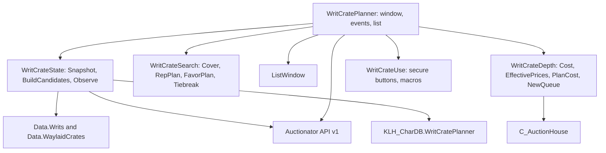

# Deep Dive: Writ & Crate Planner

## Overview

The Writ & Crate Planner (feature key `WritCratePlanner`, Forever only, needs Auctionator) plans the cheapest set of Craftsman's Writs, Waylaid Crates and Forged Delivery Receipts that reaches a trade camp reputation or Merchant's Favor target. Prices come from the player's Auctionator scan. It has six files, plus its data:

- `Modules/WritCrateSearch.lua`: pure search, `ns.WritSearch` (`S`).
- `Modules/WritCrateState.lua`: candidate building, observation logic, the `Learner` that turns game events into observations, bag and price snapshot, `ns.WritState` (`W`).
- `Modules/WritCrateDepth.lua`: AH price depth, `ns.WritDepth` (`D`): pure cost math plus the `C_AuctionHouse` query queue.
- `Modules/WritCrateUse.lua`: the receipt and crate-fill secure buttons and their macros, `ns.WritUse` (`U`).
- `Modules/WritCrateHistory.lua`: pure price history math for the price check, `ns.WritHistory` (`H`).
- `Modules/WritCratePlanner.lua`: feature, window, observers, shopping list, `ns.WritPlanner` (`P`).
- Data: `ns.Data.Writs` (150 rows), `ns.Data.WaylaidCrates` (30 rows), `SealedCrates`, `UnlabeledCrate`, `DeliveryReceipt`, `CampFaction`.

## Responsibilities

- Find the cheapest cover of a rep or Favor target (bounded and unbounded knapsack).
- Combine writs with Forged Delivery Receipts (50 rep for 15 Favor and one empty crate).
- Offer options that visit fewer zones for a little more gold (travel tiebreak), and one that needs the fewest items to buy.
- Read prices, bag and bank contents, quest state and standing from the game.
- Say whether the plan is cheap, OK, high or not worth buying compared with the usual price from Auctionator's history.
- Create an Auctionator shopping list for what is still missing.
- Make macros that put receipts on empty crates and fill labeled crates, one press per item.
- Learn real writ rep and crate Favor values from the player's turn-ins.

## Architecture

## Key Files

- **`Modules/WritCrateSearch.lua`**: the algorithms.
- **`Modules/WritCrateState.lua`**: data shaping and observation rules.
- **`Modules/WritCrateDepth.lua`**: AH listing costs and the listing query queue.
- **`Modules/WritCrateUse.lua`**: receipt and crate-fill buttons, `/klh writs macros`.
- **`Modules/WritCrateHistory.lua`**: history reading, medians, verdict tiers, icon files and colours.
- **`Media/*.png`**: the chevron icons of the price check (SVG sources in `scripts/media/`).
- **`Modules/WritCratePlanner.lua`**: UI, events, shopping list, `/klh writs`.
- **`Data/Writs.lua`**, **`Data/WaylaidCrates.lua`**: row data (see [Data and Generators](<Data and Generators.md>)).

## Public Interface

### `ns.WritSearch`

| Function | Purpose |
|---|---|
| `S.Cover(items, target, step)` | Min-cost cover. Items are `{ cost, gain, unbounded? }`. Returns `{ picks, cost, gain, short }`. |
| `S.CoverTable(items, target, step)` | The cost table `dp[k]` (cheapest cost for at least `k * step` gain), made non-decreasing from the top. |
| `S.FavorPlan(crates, target)` | Plan of crate lines for a Favor target. Owned crates are bounded items (cost = fill cost), buyable crates unbounded (buy + fill). |
| `S.RepPlan(writs, target, receipts, writCap)` | Plan for a rep target. |
| `S.Tiebreak(plan, writs, threshold)` | Swap writs to reduce zones within `cheapest * (1 + threshold)`; sets `plan.cheapestCost` (the plan's cost before swaps) as that base. |

Steps used: rep 25, Favor 5. A receipt gives 50 rep (`RECEIPT_REP`) and costs 15 Favor (`RECEIPT_FAVOR`).

### `ns.WritState`

| Function | Purpose |
|---|---|
| `W.Snapshot(settings)` | Reads game state into `input`: `prices`, `owned` (bags plus, with `countBank`, the saved bank scan), `bags` (bag counts alone), `bankAt` (when the bank was scanned), `doneToday`, `onQuest`, `faction`, `level`, `observed`, `scanAge` (the newest price age in days) and `notInScan` (names of items whose price is older than that: they were not listed in the last scan, so their price is dropped and writs and crates needing them are left out). |
| `W.BuildCandidates(input)` | Returns `{ writs, crates, unpriced, lowLevel }`. |
| `W.Standing()` | Camp faction standing and the Favor currency (ID 3402). |
| `W.BagCounts()`, `W.SealedCounts(sealed)`, `W.ScanBank()`, `W.ContainerIDs(env)` | Item counting (`SealedCounts` counts only the sealed crate IDs). |
| `W.Api()` | The Auctionator API table or nil. `W.CALLER` is the caller name, `W.FAVOR_CURRENCY` the currency ID 3402. |
| `W.Learner.New({ data, observed })` | Event-driven learner with `OnQuestComplete(questID, standing)`, `OnTurnedIn(questID, now)`, `OnFaction(standing)`, `Tick(now, standing)`, `OnCurrency(id, change, now)` and `OnBags(counts, now)`. Each returns the observations to record (`OnTurnedIn` also returns the time its 5 s window ends). `standing` may be a function. |
| `W.Observe(store, event)`, `W.Record(event)`, `W.Observed()` | Store observations. |
| `W.SettleWrit`, `W.CrateFavor`, `W.DepartedCrate`, `W.SealedRow`, `W.SealedKey`, `W.PastFriendly` | Observation rules (pure). |

### `ns.WritDepth`

| Function | Purpose |
|---|---|
| `D.Cost(listings, n)` | Buys `n` up from the cheapest of `{ {unitPrice, quantity}, ... }`. Returns the total (nil when fewer than `n` are listed) and the listed quantity. |
| `D.Needs(plan, owned, bundleOf, onQuest)` | `{ [itemID] = count }` still to buy, from `P.ShoppingTerms`. |
| `D.EffectivePrices(needs, listings, scanPrices)` | Scan prices with each fetched item replaced by its depth total / count. Marks `{ live, short }` per needed item. |
| `D.PlanCost(plan, owned, listings, scanPrices, bundleOf, onQuest)` | Real cost of a plan under those prices: the items still to buy at their effective prices plus the owned mats it uses (`P.OwnedMats`) at the same prices. |
| `D.ShortAtScan(needs, available)`, `D.ScanAvailable(needs)` | Items needing more than Auctionator's last scan listed (`Auctionator.Database:GetPriceHistory(tostring(itemID))[1].available`, internal, pcall-guarded). |
| `D.AuctionatorScanning()`, `D.ScanOutdated()`, `D.StartScan()` | Auctionator's full scan: running, due under its autoscan interval, start it (internal, pcall-guarded). |
| `D.NewQueue(api)`, `D.LiveApi()` | One-at-a-time listing queries; `q:Run(ids, onProgress, onDone)`, `q:Cancel()`, `q:OnEvent(event, arg)`. `LiveApi` wraps `C_AuctionHouse` and `C_Timer`, or returns nil. |

### `ns.WritHistory`

| Function | Purpose |
|---|---|
| `H.ReadHistory(itemIDs)` | `{ [itemID] = { [day] = low } }` from `Auctionator.Database:GetPriceHistory(tostring(itemID))` under `pcall` (internal). Empty when it is missing. |
| `H.Today(now)` | The current Auctionator day number (`Auctionator.Constants.SCAN_DAY_0`, else 2020-01-01). |
| `H.Median(list)` | Median of numbers, nil for an empty list. |
| `H.TypicalPrices(history, today, windowDays, fallback)` | Each item's median daily low in the window (the scan price when it has none), and the number of days with any low. |
| `H.DaysCovered(history, itemIDs, today, windowDays)` | Number of distinct days in the window (today left out) on which any of `itemIDs` has a low. |
| `H.DayPrices(history, today, windowDays, fallback)` | One price set per day that has a low, each item at its low that day or its last earlier low. |
| `H.Verdict(todayUnit, usualUnit, s)` | `{ tier, pct }` or nil; the difference is rounded to a whole percent once, the tier judges that value and `pct` is it divided by 100, so the shown percent and the tier always agree. `TIER_LABEL`, `TIER_COLOR` and `TIER_ICON` belong to the tiers `cheap`, `ok`, `high`, `dontbuy`. |

### `ns.WritPlanner`

Pure helpers: `P.GainTo(standing, target)`, `P.ParseAmount`, `P.CleanAmount`, `P.FormatNumber`, `P.FormatMoney`, `P.ShortMoney`, `P.ResetText`, `P.ReceiptHowTo(g, r)`, `P.ShoppingTerms(plan, owned, bundleOf, onQuest)`, `P.OwnedMats(plan, owned, bundleOf, onQuest)`, `P.BankText(plan, bundleOf, onQuest)`, `P.BankAge(scannedAt, now)`, `P.CostSplit(plan)`, `P.RepriceLines(plan, prices, input, bundleOf)`, `P.CheapestAt(r, prices, settings)`, `P.PriceCheck(r, settings, history)`, `P.PricePct(pc, level)`, `P.YoungNote(pc)`, `P.MissingNames(terms)`, `P.EmptyCrates(input)`, `P.SwitchMode(state, mode)`, `P.RestoreState(state, saved)`, `P.FewestBuys`, `P.Frontier(options)`, `P.NeedIDs`. View builders: `P.OptionLabel`, `P.OptionRows`, `P.PlanLines`, `P.Groups(plan, mode)`, `P.ReceiptSteps`, `P.Entries`, `P.WindowRows`, `P.Summary(r)`, `P.Footer(r)`.

### `ns.WritUse`

| Function | Purpose |
|---|---|
| `U.ReceiptPlan(items, skip)` | From bag items: receipts, empty crates (labeled or unlabeled), uses and the first target crate. `skip` holds crate itemIDs that refused a receipt. |
| `U.FillPlan(items, skip)` | Labeled crates that one stack can fill with one of their bundles: uses, the first crate and its stack. |
| `U.MacroBody(kind)` | The macro text for `receipt` or `fill`. |
| `U.ScanBags()` | Bag items as `{ bag, slot, itemID, count }`. |
| `U.Init()`, `U.MakeMacros()` | Build the buttons (deferred out of combat); create or update both macros and open the macro window. |

## Implementation Notes

### Search (WritCrateSearch)

`solve(items, target, step)` is a knapsack over gain quantised to `step`. Each item has a gain rounded to steps. Unbounded items loop upward, bounded items downward. The state `K = ceil(target / step)` is the first state that meets the target, and gains beyond it are clamped to `K`. A `layers` table records the choice so `Cover` can rebuild the picks.

`RepPlan` loops over the number of receipts `r` from 0 to `ceil(target / 50)`. For each `r` it adds the writ cost for the rest of the target, the cost of buying empty crates (`max(0, r - ownedEmpty)` at `crateCost`), and the Favor cost of the remaining Favor after the Favor balance (when `useBalance`). Feasible plans beat infeasible ones, then lower cost wins. If no plan reaches the target the one with the most gain is used and `short` is reported. Empty crates that the Favor plan would itself use are removed from the pool (`withoutEmpties`), crates with the lowest Favor per fill cost first. `writCap` limits the rep that writs may give, used when the player is past Friendly and writs give nothing more.

`Tiebreak` keeps the plan's non-writ lines, then repeatedly swaps one writ for an unused writ when the new total stays within the limit, the gain still meets the target, and the zone count drops. It picks the swap with the smallest cost increase. It sets `plan.cheapestCost` first; the threshold is measured from it.

### Candidates (WritCrateState)

- Writs: skipped when the quest is done today, the faction does not match (`friendly` holds `A`, `H` or `AH`), or the character is below level 10 (`lowLevel`). Cost = writ price (0 if the writ or its quest is already held) + price x missing item count. If either price is missing the writ goes to `unpriced`. Rep = the observed rep for its tier (rounded down to a multiple of 25) or the table value.
- Crates: the cheapest priced bundle fills the crate. A crate is a candidate when owned or buyable. Favor = observed value for `<tier>:<kind>`, else the bundle value, else the row value. `confirmed` is true when observed or when the row is confirmed.

### Observations

See workflow 6 in the [Workflow Overview](<../3. Workflow Overview.md>). The planner's event frame (`RegisterObservers`) only forwards `QUEST_COMPLETE`, `QUEST_TURNED_IN`, `UPDATE_FACTION`, `CURRENCY_DISPLAY_UPDATE` and `BAG_UPDATE_DELAYED` to a `W.Learner` and records what it returns with `W.Record`. `W.Observed()` also clears an obsolete `crateFavor` key. `W.CrateFavor(row, gain, known)` accepts a gain equal to the known value, twice the known value for confirmed crates (returns the single value), or a multiple of 5 between 5 and 80 for unconfirmed crates.

### Window and events

- Top row: a joined Rep | Favor toggle (the selected half filled with the accent colour), the amount box (skinned with EUI's `S.EditBox` when present) with a dropdown arrow inside it (rep mode only; `UI.SetArrowTexture` uses EUI's `Azerite-PointingArrow` when skinned, else the first atlas the client has, `common-dropdown-a-button` or `common-dropdown-classic-a-buttonDown`, else the `UI-ChatIcon-ScrollDown-Up` file, since Forever loads the Camelot UI), and Search. The box keeps digits only: typed or pasted text goes through `P.CleanAmount` (every non-digit stripped, at most 9 digits), and Enter runs Search. The arrow opens our own menu below the box, exactly as wide and left-aligned (`UI.DropdownMenu`, an EUI `S.Panel` when skinned), listing Friendly to Exalted with the rep still needed right-aligned (step sizes 3000, 6000, 12000, 21000); picking one only writes that number into the box. Bottom buttons: Reset (clears the target, the pick and the result, and cancels a running search) and Create Auctionator list.
- Outdated prices: a search at the AH first asks Auctionator's scan frame whether a new scan is due under its own autoscan interval (`D.ScanOutdated`: `IncrementalScanFrameRef:IsAutoscanReady()`) and, if so, starts it (`D.StartScan`: `InitiateScan()`, what Auctionator's Scan button does); both internal, under pcall. The summary reads "Refreshing outdated Auctionator prices first..." and the search runs when the scan ends. Away from the AH nothing can be refreshed; the info icon's title still warns about an old scan.
- While a search runs (adding up listings or waiting for Auctionator's scan) the Search button reads Cancel and stays clickable (`P.Cancel`): it stops the lookups at once and shows the options at Auctionator's cheapest prices, or goes idle when it was still waiting. Hiding the window (`OnHide`, `P.StopAll`) stops everything: the lookups, a waiting search, the scan watcher and a shopping list still waiting for item names; a search interrupted that way is dropped, so reopening shows the idle view.
- Calculating only happens on Search (or Enter). Opening the window shows the last result, or an idle summary ("Press Search to plan +X rep.") when there is none; opening, switching Rep/Favor and Reset never calculate, and switching mode or Reset also stops a running lookup and goes idle. Settings changes, "Add up listings from" included, apply on the next Search. Each search saves its goal (`KLH_CharDB.WritCratePlanner.plan.goal`: current rep total or Favor plus the target). On open the box is set to the goal minus the current value, cleared when reached, and the last result is dropped when the rep or Favor changed since it was made or the daily writ reset passed (`r.stamp`).
- The "Writ Planner" button is attached to the Auction House frame on `AUCTION_HOUSE_SHOW`, with one retry on the next frame, and hidden on close. Opening beside the AH anchors the window to the AH's top right in the button's place at the AH's height (`window:SetFixedHeight`); reopening shows the last result (a run cancelled by closing the AH is dropped, so the next open shows the idle view); the button is hidden while the window is shown (frame `OnShow`/`OnHide` hooks) and comes back when it closes with the AH still open. A window opened from that button closes with the AH (its depth run is cancelled first). A window opened with `/klh writs` stays open.
- Options: rep mode builds the cheapest plan once (`S.RepPlan`), then a `S.Tiebreak` copy for each level in `LEVELS` (`{ 0, 0.05, 0.1, 0.2, 0.4 }`). `P.Frontier` keeps the cheapest, then only plans with fewer zones than every cheaper one. A "Fewest buys (N items)" option is added when it needs fewer Auctionator list items than every other option: `P.FewestBuys` runs `S.RepPlan` with a 1000g penalty per writ (so the solver minimises the writ count first, then cost) and takes the penalty back off the lines. Favor mode has one option. Every option's cost comes from `P.RepriceLines`, which prices each line and draws owned items from one pool across all lines (like `P.ShoppingTerms`), so owned writs, writ items and crate bundle materials are not charged and not counted twice; it runs for every option and again after the listing lookup. The list shows one row per option (`P.OptionRows`): "Cheapest", then "-N zones, +Xg YYs" against the cheapest (`P.OptionLabel`, `P.ShortMoney`), with cost and zones (Favor in Favor mode) on the right. Nothing is selected after a search: there is no summary and Create Auctionator list stays disabled ("Pick an option first: click one of the results.") until a row is clicked (`state.pick`, the option's level; Search and Reset clear it). Hovering a row shows a compact tooltip (`P.PlanLines` through `UI.ShowLinesTooltip`): the option name as title, Cost, Gain, Zones (rep mode), Items to buy and the Favor rows as label/value rows, then one line per group (`P.Groups`: "Name (count)" with cost and gain); a tooltip taller than 95% of the screen is scaled down. Picking an option (`P.WindowRows`) pins a button-style "Show other options" row and the picked option's row (without the selection highlight; it stays picked) above the scroll area (they do not scroll), with that option's lines (`P.Entries`) scrolling below. Group headers start folded and open when clicked (`state.view.open`); a header reads "Name (count)" with cost and rep on the right like its rows, rep counting writs and receipts in rep mode. "Show other options" clears the pick and goes back to the plain option list; Search and picking reset the open groups.
- While a depth run fetches listings the summary reads "Adding up AH listings..." with "N of M items", the rows show the scan-priced options without popups or picking, Search reads Cancel, and Create Auctionator list is disabled ("Still adding up AH listings."). While Auctionator runs a full scan (`D.AuctionatorScanning`: `Auctionator.State.IncrementalScanFrameRef.doingFullScan`, internal, read under pcall) nothing is calculated: a Search shows "Waiting for Auctionator..." and stops any running depth run, and the depth queue counts the scan as busy. Without a waiting search, Search is disabled during the scan with an explaining tooltip. While the window is shown, an `OnUpdate` check every 0.5 s (`P.SyncScanState`) redraws it when a scan starts or ends and runs a waiting search once the scan is done, so Search follows the scan even when nothing else happens.
- Mode, the target text and the goal are saved per character in `KLH_CharDB.WritCratePlanner.plan` (`mode`, `target`, `goal`) on each Search and on Reset, and restored when the window is built (`P.RestoreState`).
- Info icon (`P.Footer` returns `{ lines, text, warn }`): the title shows the scan freshness ("Prices from today's scan", orange "Scan is N days old: rescan the AH", otherwise "Planner info"), then the price source, Friendly cap, level and reset lines, then "Not in your last scan" and "No price" ("No price or none listed" at the AH) as headed sections with one name per line (at most 8, then "and N more"; names already under the first are not repeated). The icon in the title bar shows them on hover (`window:SetInfo`); it is always there ("Nothing to note yet." when there is nothing) and turns orange when one is a warning. There is no footer under the list.
- Layout: `P.Summary` is pinned above the list only when it adds something: the waiting and loading states, the idle prompt, the reason for an empty plan ("Writs need level 10.", "Every writ is done today. <reset>", "Nothing priced to plan with. Scan the AH with Auctionator first." or "Nothing to plan with: no writs or crates are available."), or, for the picked option, the Favor it uses and the orange shortfall (cost, gain and zones are on the option's row). The prompt for no target reads "Type a target amount, or pick a standing." in rep mode and "Type a target amount." in Favor mode, which has no standing arrow. `P.Entries` groups a plan's writs under zone headers in plan order, each row the name with owned and listing notes and cost and gain. In rep mode the crates and receipts come last as the "Receipts (N)" group; in Favor mode the crates are the only group and have no header.
- Item tooltips: hovering a writ row shows the writ's item tooltip, a crate row (and the receipt steps' fill and buy rows) the crate's, with the planner's hint (bundle, turn-in NPC) below it.
- Bank scan: on `BANKFRAME_OPENED` and while it stays open, `W.ScanBank` saves counts and a timestamp to `KLH_CharDB.WritCratePlanner.bank`. If no slots are readable the old scan stays.
- Owned items: mats (a writ's requested items and crate fill items) always count at their AH price, owned or not, so every option is compared at full value; only owned writ scrolls, owned crates and owned empty crates are free. An owned mat without a price is free rather than unplannable. `P.RepriceLines` draws owned items from one pool across lines, bags first, then the bank: each line keeps `fromBank` (shown as an orange "(N from bank)"), and the plan keeps `ownValue` (owned mats used, at their price) and `fromBank` (itemID -> count). Owned labeled crates and the owned empty crates receipts go on draw from the same pool: owned crate lines first, then the empties (`count - bought` of a receipt line) over the crate types `P.EmptyCrates` counts (labeled crates in data order, then the unlabeled crate), bags of every type before the bank; their banked part lands in `fromBank`, `bankNames` and the line's `fromBank` (the "Nx empty crates you have" row shows it). Their cost stays 0. The pinned summary (reading `bundleOf` and `onQuest` of the round the shown option came from, `r.view`) then says "Get from your bank first: 9 Dream Dust, 4 Small Brilliant Shard" (plus " (bank seen N days ago)" when the scan is a day old) and "Cost X: buy Y, your mats Z"; the option tooltip adds "To buy", "Your mats" and the bank line. The Auctionator list still holds only what to buy.
- Settings: "Count bank items", "Spend my Favor on receipts" and "Add up listings from" (2 to 100, default 10) in one row, then the "Create macros" button in its own row. Defaults: `countBank = false` (bank items you have not taken out made plans short at the AH), `useFavorForReceipts = false`, `liveMinQty = 10`. Changes apply on the next Search. The price check has its own settings, see Price check.
- Receipt and crate macros (`Modules/WritCrateUse.lua`, `ns.WritUse`): two hidden secure buttons are made at login (out of combat), `KLHApplyReceiptButton` and `KLHFillCrateButton` (`SecureActionButtonTemplate`, `useOnKeyDown = false`). Each item use needs a real click or key, so an account-wide (General) macro `/click`s them: "KLH Receipt" (`#showtooltip item:262902`) and "KLH Fill Crate", both made or updated by the settings button Create macros or `/klh writs macros` (`U.MakeMacros`: `CreateMacro`/`EditMacro`, not in combat), which removes older character copies (`DeleteMacro`), closes our settings window and Blizzard's settings panel (`ns.CloseOptions`) so nothing covers it, and opens Blizzard's macro window on the General tab with KLH Fill Crate selected (`ShowMacroFrame`, `MacroFrame:ChangeTab(1)`, `SelectMacro`). KLH Fill Crate has no `#showtooltip` and uses the labeled crate's own icon (`C_Item.GetItemIconByID(248682)`) to drag them from. The buttons use Blizzard's item action with item targeting (`type = "item"` plus `target-bag`/`target-slot`, which `SecureActionButtonTemplate` applies with `C_Container.UseContainerItem` when the item's spell can target an item). They are re-armed out of combat before each press, on bag changes and when combat ends: the receipt button uses `item:262902` on the first empty Waylaid Crate (labeled or unlabeled, `U.ReceiptPlan`); the fill button uses the first labeled crate (`item = "<bag> <slot>"`) on a single stack that covers one of its bundles (`U.FillPlan`; unlabeled crates need their label read first and are skipped). A press that works prints nothing. After one, further presses are ignored (the button is disarmed in `PreClick`) until `BAG_UPDATE_DELAYED` shows the result, `UNIT_SPELLCAST_FAILED`/`INTERRUPTED` ends it, or 3 s pass, and while the player casts or channels; so spamming cannot aim twice at the same crate before the bags update. If the game refuses a target, the targeting cursor is still up in `PostClick`, so the button cancels it (`SpellStopTargeting`), remembers that crate kind as refused for the session, prints why ("A receipt could not go on <crate>: the game refused it as a target..." or "<crate> could not be filled from <stack>..."), and the next press tries another crate. With nothing to do a press prints that.
- Receipts: in rep mode the crates and receipts of a plan form a "Receipts (N)" group (N receipts; its rep is the receipts' rep), listed as items like the Favor view (`P.ReceiptSteps`): one row per crate to fill ("77x Journeyman Textiles", cost and Favor, tooltip names the bundle), the empty crates to buy ("62x Waylaid Crate (empty)") or "Nx empty crates you have", and "Nx Forged Delivery Receipt" (rep; tooltip: the Scribe, the Favor it costs). Each item row shows the game's item tooltip on hover. A last grey row, without a right column so it wraps, explains the flow in one sentence written from the plan (`P.ReceiptHowTo`): "Fill the Journeyman Textiles crates and turn them in for Favor. Buy 62 receipts at the Scribe with that and your own Favor. Put one on each empty Waylaid Crate and turn it in." (it names the bought crate type only when every receipt goes on a bought empty, else "empty crate"); its tooltip adds the Scribe and the KLH Fill Crate and KLH Receipt macros.
- Names: every item label is the game's full item name through `P.ItemLabel(itemID, fallback)`, `P.WritName(ref)` ("Craftsman's Writ: ...") and `P.CrateName(ref)` ("Waylaid Crate: ...", or "Waylaid Crate" for the unlabeled one); our data's full name is only the fallback until the game has the item cached. No row abbreviates names. The window is 420 px wide so full names fit.
- Money: `P.FormatMoney` shows gold and silver from 1g up (copper rounded into silver) and silver and copper below; `P.ShortMoney` is the same format, so rows, headers and option labels match.
- Receipts: from Friendly on, `S.RepPlan` always weighs receipts against writs. "Spend my Favor on receipts" (`useBalance`) only decides whether the Favor you have pays first: on, your balance is spent, then crates are filled for the rest; off, all the Favor comes from filled crates and your own is kept. A plan with receipts carries `plan.favor = { need, fromBalance, fromCrates }`; the option popup has "Favor for receipts", "Paid with your Favor" (only when spent) and "From crates" rows.
- Shopping list: `ConvertToSearchString(CALLER, { searchString, isExact = true, quantity })` per term, then `CreateShoppingList(CALLER, "KLH Writs" or "KLH Crates", terms)`. `CALLER` is "KlausisLittleHelpers".
- With the AH open, Create Auctionator list then switches to Auctionator's Shopping tab (`AuctionatorTabs_Shopping:Click()`, the same call Auctionator's own `MultiSearch` API makes) and fires `Auctionator.Shopping.Tab.Events.ListSearchRequested` with the new list on `Auctionator.EventBus`, which opens and searches it (`P.OpenShoppingList`; the event part is internal, under pcall, so only the tab switch remains if it changes).
- The feature is `alwaysOn` and registers `/klh writs` even when Auctionator lacks the needed API (the command then prints that it needs Auctionator).

### Price check

The check tells whether the plan's cost per rep (rep mode) or per Favor (Favor mode) is a good deal against the usual cost for the same target and mode. It never judges single items. The only price data is Auctionator's saved daily history (`H.ReadHistory`).

- `P.PriceCheck(r, settings)` runs in the Search path right after `Calculate`, before the result is shown, on the scan-price options, and `FinishDepth` keeps its usual unit, method and days and judges the options it ends with again (`P.RejudgeAtScan`): each final option's plan is repriced at the scan prices (`RepriceLines(o.plan, run.scan, ...)`) and its unit compared with the kept `usualUnit`, so the verdict describes the plan shown, with no extra planner run. Today's side is each option's `plan.cost / plan.gain` at scan prices; `P.PriceCheck` and `P.RejudgeAtScan` share the per-level judging (`JudgeLevels`).
- `P.CheapestAt(r, prices, settings)` builds the usual plan with the same pipeline as today's plan (`BuildCandidates`, then `RepPlan` or `FavorPlan`, then `RepriceLines`) and the same owned items, done-today writs, standing and target. Only the prices are swapped. The cheapest plan is used, with no tie-break or zone options.
- "Usual price from" (`priceMethod`): Typical prices (`typical`, default) prices each item at its median daily low over the last `historyDays` days before today (today itself is left out) and plans once. Past days (`days`) plans once per past day (`H.DayPrices`) and takes the median of the unit costs; it costs up to 21 planner runs per Search, done once.
- Verdict (`H.Verdict`): `pct = round(100 * (today / usual - 1)) / 100`. Cheap when `pct <= -cheapBelow`, Don't buy when `pct > dontBuyAbove`, High when `pct > highAbove`, else OK. The result is `r.priceCheck.byLevel[option level] = { tier, pct, unit }`, plus `method`, `days` and `usualUnit`.
- No verdict, `r.priceCheck.reason`: `none` ("No price history"), `few` ("Not enough price history (N days)", fewer than `minDays` days, capped at `historyDays`, have price history for the items of today's cheapest plan: its writs, writ items, crates and bundle items, as `H.DaysCovered` counts them; `days` in the result is that count), `empty` and `short` (both "No usual price for this target": the usual plan is empty, or reaches less of the target than today's plan).
- Settings (planner options, "Price check" header, below the toggles):

  | Setting | Key | Values | Default |
  |---|---|---|---|
  | Usual price from | `priceMethod` | Typical prices / Past days | Typical prices |
  | History days | `historyDays` | 3 to 21 | 14 |
  | Minimum days | `minDays` | 2 to 14 | 5 |
  | Cheap below (%) | `cheapBelow` | 5 to 50 | 15 |
  | High above (%) | `highAbove` | 5 to 100 | 15 |
  | Don't buy above (%) | `dontBuyAbove` | 20 to 200 | 50 |

  Auctionator keeps 21 days by default, so a longer window adds nothing.
- Display:
  - Each option row gets a tinted chevron before its cost (`entry.icon`, see [UI and ListWindow](<UI and ListWindow.md>)): Cheap one chevron down, green; OK none; High one chevron up, orange; Don't buy two chevrons up, red. The shapes differ so it reads without colour vision.
  - The summary has no price line: the chevron on the option row (also on the pinned picked row) is the verdict at a glance.
  - The option popup gets a "Price check" row like Cost and Gain: the change against usual right aligned in the tier colour (`P.PricePct`, e.g. "+44%"), or the reason, followed by "Per rep" (or "Per Favor") and "Usual" rows with the two costs per unit.
  - While the history has fewer than 10 days, the tooltip row adds a grey "(N days)" (`P.YoungNote`), so a verdict from a short history reads as a rough one. No prices ship with the addon: Auctionator's history is per realm and faction, so baked-in values would judge other auction houses wrongly and go stale.
  - The info icon lists "Price check: Typical prices, N days" (or "Past days"), or the reason when there is no verdict.
- Icons are our own white 32x32 RGBA PNGs in `Media/`, drawn as SVG in `scripts/media/` and tinted in code with `SetVertexColor`. Inline `|A:...|a` and `|T:...|t` markup does not render on Forever (tested in game in a tooltip and in chat), which is why the icon is a texture on the row.
- Not yet checked: whether newly added `Media` files load after `/reload` or need a client restart.

### AH price depth

- At the AH (`AUCTION_HOUSE_SHOW` until `AUCTION_HOUSE_CLOSED`), each Search first plans from scan prices, then queries live listings only for items the options need at least "Add up listings from" of (setting `liveMinQty`, 2 to 100, default 10; owned items are subtracted first). Writs and their items are mostly needed a few at a time and keep the scan price, whose lowest listing already covers a small buy; crate fills and empty crates for receipts usually pass the limit, since large buys run through many listings. With nothing to check, the plan stays on scan prices with the "(only K listed at last scan)" hints. The summary shows "Adding up AH listings..." with "N of M items".
- The queue sends one `SendSearchQuery(itemKey, {{ sortOrder = Price }}, false)` at a time, 0.3 s apart. It waits while `IsThrottledMessageSystemReady()` is false or Auctionator's own search queue (`Auctionator.AH.Queue.queue`, internal) is not empty, retrying on a timer and on `AUCTION_HOUSE_THROTTLED_SYSTEM_READY` (events never cut the 0.3 s gap short). It waits for `GetItemKeyInfo` before searching (queries for uncached keys are ignored, as Auctionator found), up to 20 timer steps (about 6 s), retries a query after 5 s without results up to 3 times, then skips the item (it keeps its scan price).
- The result path follows the event: `COMMODITY_SEARCH_RESULTS_UPDATED` reads `GetCommoditySearchResultInfo` (`unitPrice`, `quantity`), `ITEM_SEARCH_RESULTS_UPDATED` reads `GetItemSearchResultInfo` (`buyoutAmount / quantity`; `buyoutAmount` is the whole auction's price, and bid-only auctions are skipped). `GetItemCommodityStatus` takes an `ItemLocation`, so it cannot classify items by ID.
- Results are cached per item until the AH closes; Search clears the cache and fetches again. A new Search cancels the run; closing the AH stops it and uses the partial results.
- Replanning: effective prices for the needed quantities feed `W.BuildCandidates` and the search again, up to 3 rounds, fetching items new to the plan (an item that failed is not asked for again in the same run). Needed quantities are the union over all options (the largest count per item). For each option level the lowest `D.PlanCost` across rounds wins (each keeps the round it came from for its crate bundles). Its lines are then re-priced with the same effective prices (`P.RepriceLines`, on copies, since options share crate and receipt lines, with owned items drawn from one pool), and its total becomes the sum of its lines, so the option row, the group headers and the lines always agree. The frontier of those live-priced options is shown. Favor-mode options show no zones. The info icon says "N items priced by their listings, M at Auctionator's cheapest".
- Too few listed: the listed part costs its listings and the rest the higher of the dearest listing and the scan price. The line is marked "(only K listed)".
- None listed: the item has no price, so writs and crates needing it are left out (the info icon lists it under "No price or none listed") and `D.PlanCost` of a plan that needs it is nil, so that plan is never chosen. Fetched items outside the current needs are priced at their cheapest listing.
- Away from the AH, lines needing more than Auctionator's last scan saw are marked "(only K listed at last scan)"; this hint is off if Auctionator's internals change.
- Listing marks live only on the options (`o.marks`: `{ live, short }` from `D.EffectivePrices`, or `{ short, atScan = true }` for the last-scan hint). An option view keeps a reference to its option (`OptionView`, field `option`) and reads them live through `MarksOf`, so each option's popup shows its own notes; the info icon counts the picked (or first) option's marks with `LiveCounts`. Code layout: `Calculate` builds the result, `RepOptions` the rep options (`ReceiptInput` for the receipts input), `SetOptions` (frontier, Fewest buys, selection) is shared with `FinishDepth`; `Show` draws, `UpdateButtons` sets the Search/Cancel and action button states; `Unpriced` filters the info icon's no-price list.
- Not yet checked in game: whether Forever trade goods are commodities, the real throttle behaviour, and whether the first commodity result page is enough (more pages are not requested).

## Dependencies

- Internal: `ns.UI`, `ns.CreateListWindow`, `ns.CreateWindowButton`, `ns.GetSettings`, `ns.RegisterSlashCommand`, `ns.Data`.
- External: Auctionator API v1 (`GetAuctionPriceByItemID`, `GetAuctionAgeByItemID`, `ConvertToSearchString`, `CreateShoppingList`), Auctionator internals (`Database:GetPriceHistory`, `AH.Queue`, guarded), `C_AuctionHouse`, `C_Timer`, `C_Container`, `C_QuestLog`, `C_Reputation`, `C_CurrencyInfo`, `C_DateAndTime`, `C_Item`.

## Testing

- `cover_test.lua`: `Cover` and `CoverTable`.
- `plan_test.lua`: `FavorPlan` and `RepPlan` with owned and bought crates, receipts and caps.
- `optimal_test.lua`: compares `S.RepPlan` and `S.FavorPlan` with a brute force that tries every writ subset, receipt count, crate count and split of owned crates between filling and receipts, on 650 seeded random cases (writs only, with receipts and bought crates, with owned crates). Any plan dearer than the true cheapest fails the test.
- `tiebreak_test.lua`: `Tiebreak` with 5 percent and 1 percent thresholds.
- `writuse_test.lua`: `U.ReceiptPlan` (receipts across stacks, labeled and unlabeled crates, refused crate kinds), `U.FillPlan` (one stack per bundle, unlabeled crates skipped, refused kinds) and `U.MacroBody`.
- `candidates_test.lua`: `BuildCandidates` (done today, unpriced, faction, bank container IDs).
- `observe_test.lua`: `Observe`, `SettleWrit`, `CrateFavor`, `DepartedCrate`, `SealedRow`, `PastFriendly`, and candidates using observed values.
- `writhistory_test.lua`: `H.Median`, `TypicalPrices`, `DaysCovered`, `DayPrices`, `Verdict` thresholds and rounding, and `ReadHistory` with a stubbed Auctionator database (non-table internals and rows ignored).
- `pricecheck_test.lua`: `P.CheapestAt`, `P.PriceCheck` (both methods, each reason, minimum days over the plan's items only), `P.RejudgeAtScan` and the display helpers (`P.PricePct`, `P.YoungNote`, the tooltip rows).
- `plannerevents_test.lua`: the planner's event frames and window wiring with mocked frames and Auctionator.
- `writdepth_test.lua`: `Cost` (single and many tiers, too few, none), `Needs` with owned items, `EffectivePrices`, `PlanCost` (owned mats valued), `ShortAtScan`.
- `writdepthqueue_test.lua`: the queue with a stubbed API: commodity and item paths, throttle and Auctionator waits, key info wait, stale runs, AH close, cache, timeouts.
- `writdepthwiring_test.lua`: planner wiring with stubbed `C_AuctionHouse` and Auctionator: scan hint, replanning onto the really cheaper writ, live marks and info lines, the verdict of the live-priced options, cache reuse, AH closed mid-run.
- `planner_test.lua`: `GainTo`, `ParseAmount`, `CleanAmount`, `FormatNumber`, `FormatMoney`, `ShortMoney`, `ResetText`, `ShoppingTerms`, `RepriceLines`, `MissingNames`, `EmptyCrates`, `SwitchMode`, `RestoreState`, `FewestBuys`, `Frontier`, `NeedIDs`, `OptionLabel`, `OptionRows`, `PlanLines`, `Entries`, `WindowRows`, `Summary`, `Footer`. It stubs `ns.RegisterFeature` so the module loads.
- `data_test.lua`: row counts (150 writs, 30 crates), a known writ, sealed crate rows, and that most rows have turn-in data.
- `writlearner_test.lua`: `WritState.Learner` fed in the client's event orders: writ turn-ins, late reputation, Friendly zeros, crate gains before and after the bag update, the 5 second window and halving.

Frame drawing and live Auctionator calls are not tested.

## Potential Improvements

- `RepPlan` recomputes Favor tables per used-empty count with a cache, but the loop over receipts is O(target / 50) tables. It is fast now. A very large target on a slow client could be noticeable.
- Away from the AH prices use the lowest listing; the info icon says "Auctionator's cheapest price; buying many can cost more.". Replanning with effective prices is not guaranteed optimal when several items get much dearer at once.
- Writ and item names depend on `C_Item.GetItemNameByID`, which can be empty until item data is cached. The fallback is the name from the data file.
- Unconfirmed Artisan crate Favor values stay marked "(unconfirmed)" until one is observed.
